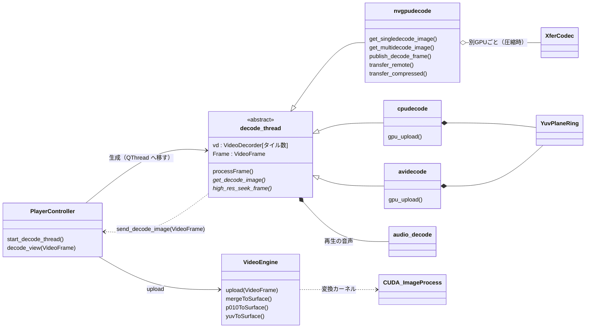
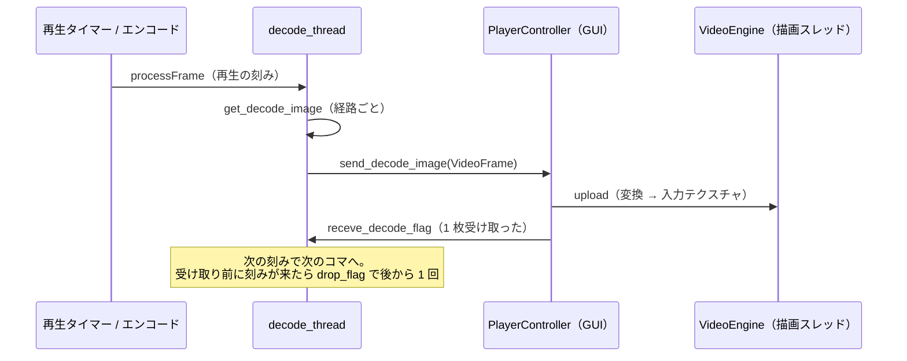
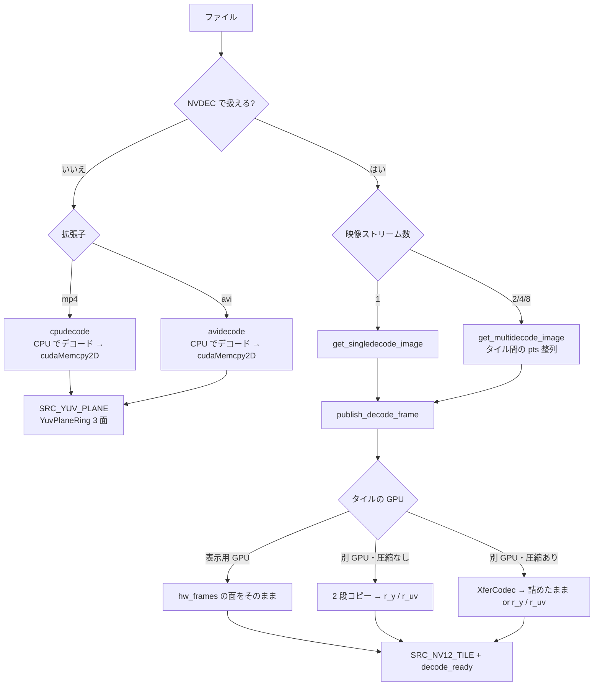

# デコード（再生）のコア

ファイルを開いてから、1 フレームが GL の入力テクスチャ（RGBA8 / RGBA16）に書かれるまで。
経路（AVI / CPU / NVDEC 1 タイル / NVDEC マルチタイル / マルチ GPU / 圧縮マルチ GPU）と 8bit / 10bit の組み合わせをすべて扱う。
1〜7 節が全経路の共通の仕組み、8 節がマルチ GPU デコード（割り振り・転送・圧縮・同期・性能 HUD・実測）の詳細。
テクスチャから先（画像処理・表示ツール・ヒストグラム）は `IMG_PROCESS_CORE.md`、画面は `QML_UI_CORE.md`、書き出しは `ENCODE_CORE.md`。

## 1. 全体像



- デコードは専用スレッド（`decode_thread` を `QThread` に移す）。画素の変換はしない。結果の GPU 上のポインタを `VideoFrame` に載せて送るだけ（ゼロコピー）。
- 変換（YUV → RGBA）は GUI 側（`VideoEngine::upload`、描画スレッド）が CUDA で GL の入力テクスチャへ直接書く（surface）。
- 受け渡しは「GUI が 1 枚受け取ったらデコードが次へ進む」ハンドシェイク（3 節）。

## 2. ファイル

| ファイル | 役割 |
|---|---|
| `src/qmlui/playercontroller.cpp` | デコーダの選択（`start_decode_thread`）、`decode_view` で VideoEngine へ |
| `src/videoprocess/decode_thread.*` | 基底。ループ（`processFrame`）、ハンドシェイク、先行、シーク、フレーム番号と pts、エンコード用の音声 |
| `src/videoprocess/nvgpudecode.*` | NVDEC（`*_cuvid`）。1 タイル / マルチタイル、タイル間の pts 整列、マルチ GPU の転送 |
| `src/videoprocess/cpudecode.*` | CPU デコード（MP4 で NVDEC に入らないもの） |
| `src/videoprocess/avidecode.*` | AVI（CPU デコード） |
| `src/videoprocess/yuv_plane_ring.h` | CPU デコード系の GPU 上のプレーン（3 面のリング） |
| `src/videoprocess/audio_decode.*` | 再生の音声（別スレッド） |
| `src/videoprocess/decode_gpu_map.h` / `xfer_codec.*` | マルチ GPU のタイル割り振り / 圧縮転送（8 節） |
| `src/qmlui/videoengine.cpp` | `upload`（変換の選択）、`mergeToSurface` / `p010ToSurface` / `yuvToSurface` |
| `cuda_kernels/decode_8bit.cu` / `decode_10bit.cu` / `decode_rows.cuh` | 変換カーネル（5 節） |
| `src/main/__global__.h` | `VideoFrame`（受け渡し）、`DecodeInfo`（`VideoInfo`。大きさ・ビット深度・タイル構成） |

## 3. デコードスレッド（全経路共通。decode_thread）

### 3.1 デコーダの選択（`PlayerController::start_decode_thread`）

| 条件 | デコーダ |
|---|---|
| 映像が H.264（4096×4096 以下）/ HEVC・AV1（8192×8192 以下） | `nvgpudecode`（コンテナは問わない） |
| それ以外で拡張子 `.mp4` | `cpudecode` |
| それ以外で拡張子 `.avi` | `avidecode` |
| その他 | 「非対応の動画です」 |

- タイル分割の動画 = 1 ファイルに映像ストリームが 2 / 4 / 8 本（2×1 / 2×2 / 4×2。左上から行ごとの順）。NVDEC 経路だけが扱う。
  1 本の大きさが上の上限以下なら、全体は 16K（15360×8640 = 3840×4320 × 4×2）でもよい。

### 3.2 ループとハンドシェイク



- `processFrame` を呼んでよいのは刻み（再生タイマー、またはエンコード中の自己駆動）と `receve_decode_flag` の再投入だけ。
  1 表示フレームに 2 回デコードするとリングを追い越し、GUI が変換中の面を上書きする。
- **先行**: 順方向の通常再生だけ、GUI の未受け取り（`inflight_frames`）が 2 未満なら受け取りを待たずに次の刻みでもデコードする
  （`can_decode_ahead`、`CUDA_VIEWER_DECODE_AHEAD=0` で 1:1）。一時停止はボタンより 1 コマ後で止まる。
- **表示のペース（QML 版）**: 安定した順方向の通常再生は、GUI が受け取ったコマをすぐ出さず、vblank に合わせて出したときに返事をする（3.6）。
- **エンコード中**: タイマーを切り、「1 枚受け取ったら 1 枚デコード」で自己駆動（`receve_decode_flag` の `self_drive`）。先行しない。
- **シーク**: スライダー・1 コマ送り / 戻し・高精度シークは `high_res_seek_frame`（経路ごと）。重い間は `heavy_process_signal(false)` で操作を止める。
- フレーム番号 ↔ pts の変換は `frame_to_pts` / `pts_to_frame` だけを使う（丸めを 1 か所に）。fps の宣言が怪しいファイルは
  インデックスの最小間隔で補正（`fix_frame_grid`）。

### 3.3 受け渡し（`VideoFrame`。`__global__.h`）

| `src_mode` | 送り手 | 中身 |
|---|---|---|
| `SRC_NV12_TILE` | nvgpudecode | タイルごとの `d_y / d_uv / pitch`（NV12 か P010）、`tile_count`・`tile_w`・`tile_h`、`decode_ready`（GPU の完了イベント）、圧縮転送の `tile_packed[] / packed_delta` |
| `SRC_YUV_PLANE` | cpudecode / avidecode | `d_plane[3] / plane_pitch[3]`、`plane_format`（`YUVFMT_*`）、10bit BE の `plane_is_be` |

- ポインタの有効期間は、送り手のリングが一周するまで（NVDEC: `hw_frames` 6 段、CPU 系: `YuvPlaneRing` 3 面）。
- 同時に使うのは「GUI の未受け取り ≦ 2 ＋ GUI の GPU 処理中 2（`VideoEngine::kMaxFramesInFlight`）＋ デコード中 1 = 5」で、6 段に収まる。
  リングや先行の上限を変えるときはこの式を守る（NVDEC のリングを増やすなら cuvid の `surfaces` も）。

### 3.4 音声

- 再生の音声は `audio_decode`（別スレッド。`audio_decode.h` の先頭に設計理由）。映像の位置（`play_pos_us_`、pts を秒にしたもの）に合わせる。
  音を出すのは順方向の通常再生中だけ。
- `decode_thread::get_decode_audio` はエンコードの入力（`Frame.audio_pcm`）を作るだけ（エンコード中だけ動く）。
- 音声のデコーダは `open_audio_decoder`（3 経路共通）。開けなければ音声なしで続ける（ファイルを開く失敗にはしない）。

### 3.5 失敗の扱い

| 失敗 | 扱い |
|---|---|
| 開く時（`initialized_ffmpeg` が false） | `decode_error` → GUI がダイアログ（従来どおり） |
| ファイルを読めない（`read_packet`。I/O の失敗が 50ms おき 3 回やり直しても続く） | `fail_decode` → `decode_error` → GUI がファイルを閉じてダイアログ |
| 末尾の壊れたデータ等（I/O 以外の読み込みの失敗） | EOF と同じ（終端の処理） |
| 壊れたパケット（`avcodec_send_packet`）・受け取りの失敗・シークの失敗・パケットの複製の失敗 | `warn_ffmpeg`（最初の 10 回と以降 100 回ごとにログ）で続ける |
| CPU / AVI の GPU への転送（同期 `cudaMemcpy2D`）の失敗 | `fail_decode` |
| 別 GPU のタイルの転送先を確保できない | `fail_decode` |
| 別 GPU のタイルの転送（CUDA API・nvCOMP の起動）の失敗 | そのコマは前のコマを再送（`publish_decode_frame` の先頭で取った `Frame` の写しへ戻す。番号は転送の後で進めるので進まない）。`kMaxXferFails`（30）回続いたら `fail_decode` |
| 圧縮転送の GPU 上の失敗（`XferCodec::deviceError`。8.12） | ログだけ |

- `fail_decode` は 1 回だけ `decode_error` を出し、以降の `processFrame` は何もしない。
- 再生のループ（1 タイル・CPU・AVI）は、終端 → 読み直し → 終端 を 2 回で打ち切り、範囲の終わりと同じ扱いにする
  （processFrame のミューテックスの中で回り続けると GUI まで固まるため。シークの側は従来から同じ打ち切り）。

### 3.6 表示のペース（vblank に合わせて出す。QML 版の PlayerController）

- 以前は届いたコマをすぐ `upload` していたので、画面に出る時刻 = 刻み（`fps_thread`。steady_clock）＋ デコード時間 ＋ GUI の待ち。
  刻みと画面の vblank は別の時計なのでゆっくりずれ、境目を通るあいだ swap の約 1ms の揺れで 5・3・5・3 vblank と行ったり来たりした
  （120Hz で 29.97fps の素材、10〜17 秒ごとに 1〜2 秒。キーフレームのデコード約 4ms も境目で効いた。実測は `IMG_PROCESS_CORE.md` 13.1）。
- 安定した順方向の通常再生（`render_active_`・一時停止でない・逆再生でない・エンコードしていない・シークの保持中でない）だけ、
  `decode_view` は届いたコマを待ち行列 `presentQueue_` に置き、`presentTick` が 1 枚ずつ出す（`showFrame` → `upload` → 返事）。
  - 理想の表示時刻 = 起点 ＋ k × 1 コマ（fps × 再生速度から）。計算で決まるので測った時刻の揺れが入らない。
    起点 = 最初のコマが届いた時刻 ＋ max(1 コマ, 25ms)（待ち行列にほぼ 1 コマ溜まり、キーフレームの遅れを吸収する）。
  - 理想の時刻に一番近い実際の vblank（`VideoEngine::vblankGrid`。DWM の `qpcVBlank` と周期）を選び、
    swap がその vblank の周期の真ん中に来る時刻（vblank − 周期 / 2 − upload→swap の移動平均）に `presentTimer_`（PreciseTimer）で upload を始める。
  - upload→swap の見込みは周期の半分で打ち切る（始めるのは V の 1 周期前より早くしない）。ウィンドウ表示では DWM が前のコマを
    画面に出すのは狙った vblank のさらに 1 つ後で、それより前に次の swap を呼ぶとブロックする。打ち切らないとブロックが見込みに入って
    さらに早く始める悪循環になり、60fps の素材（4K 2 倍速も）で swap 約 14.5ms・55fps に張り付いていた。
  - ただし upload を始めるのは、前のコマを出した vblank の 1ms 後より前にしない。前のコマが画面に出る前に swap すると vsync オンの
    ドライバがブロックし、その時間が upload→swap の移動平均に入って次はさらに早く始める…と悪化する（60p の素材で swap が毎回約 14.5ms
    止まり、GUI の受け取りと返事が遅れてデコードの刻みを取りこぼし、55.7fps に落ちていた）。
  - ずれが溜まって選ぶ vblank が 1 つ動くのは 1 回だけ（120Hz で 29.97fps なら約 10 秒に 1 回、5 vblank のコマが 1 枚）。
  - 前に描いたコマがまだ swap していなければ 1ms ずつ待つ（最大 20 回。1 回の swap に 2 枚描かない）。
  - 表示が追いつかないときは起点を取り直さず、理想の時刻を過ぎたコマを upload せずに捨てて追いつく（再生の速さを保つ）。
    狙う vblank は「今から始めて間に合う一番早い vblank」（今 ＋ 周期の半分 ＋ upload→swap）より前にしない。理想の時刻だけから
    決めると、遅れているとき狙う vblank も一緒に遅れて期限切れに気付けず、1 コマも捨てなかった。
    取り直すのは 0.25 秒（または 4 コマ）以上遅れたときだけ。以前は 2 コマ遅れで取り直していて、4 倍速（119.88fps）が
    画面 60fps のときに再生そのものが 60fps（実質 2 倍速）に落ちていた。
  - upload の直後にその場で描かせる `VideoEngine::renderNow`（ウィンドウへ UpdateRequest を直接送る）は**既定で使わない**
    （`CUDA_VIEWER_RENDER_NOW=1` で使う）。60fps の素材（vblank 2 回に 1 コマ）で swap が毎回約 14.5ms ブロックし、GUI スレッドが止まって
    54〜55fps に張り付いた（requestUpdate に任せると 60fps に張り付く。原因は未解明）。入れた狙い（HUD の更新で予約済みの描画に乗って
    swap が早まる、250ms 周期の 3→5 vblank）は、UI の通知を swap の後（`VideoEngine::framePresented` を Queued で受けて
    `flushDeferredUi`）に出すことで代わりに防ぐ。
  - 実測（120Hz、29.97fps、HUD あり、144 秒）: 4 vblank が 98.3%（入れる前 89.7%）、swap の位置は周期の 0.52 ± 0.11。
    残りは 約 8.7 秒ごとの 5 vblank（狙いどおり。29.97fps を 120Hz で出す限り避けられない）、HUD 由来の 3→5 の組（renderNow で対策）、
    GUI スレッドが 16〜57ms 止まったもの数回。
- **UI の定期更新は swap の直後へ寄せる**: 性能 HUD（`perfTimer_` 250ms）・動画情報（`infoTimer_` 500ms）・推移の記録（1 秒。
  `infoSampleTick`）の通知は、表示のペースの最中は印だけ付け（`deferUi`）、`presentTick` の swap の直後にまとめて出す（`flushDeferredUi`）。
  次の upload まで 20ms 以上空いているので、QML の評価も追加の描画もそこに収まる。印が付いたまま次の刻みが来たら（コマが出ていない）その場で出す。
  以前はタイマーの時刻のまま出していて、`infoChanged` の評価（約 5ms）が upload の時刻に重なるとタイマーが遅れ（5→3 vblank、2.5 秒ごと）、
  追加の描画が 1 つの vblank に 3〜4 回重なると swap が 10〜16ms 止まった（6→2 vblank）。あわせて `videoInfo` / `gpus` は
  `infoChanged` / `stateChanged` ごとに 1 回だけ作って使い回す（バインディングごとに作り直していた）。
- **返事のたびに次のデコードを促す**: 待ち行列から出した（捨てた）コマの返事のあとに `processFrame` も呼ぶ（`replyDecode(kick)`）。
  刻み（`fps_thread`）だけに任せると、返事が遅れて刻みが 2 回来たときに `drop_flag` が 1 回分しか覚えられず刻みが消え、再生が遅れる
  （性能 HUD の更新 250ms ごとに 1 回消えて、60fps の素材が 55.8fps になっていた）。消費は表示のペースが理想の時刻で決めるので、
  デコードは空きがあれば進めてよい。先行の上限（`inflight_frames < 2`）は変わらない。待ち行列を空けて刻みの経路へ戻るときは促さない。
- **受け取りの返事**: 待ち行列のコマは出したときに 1 枚ずつ `receve_decode_flag` を直接呼ぶ（Queued）。`decode_please` は
  SingleShotConnection を 1 回の emit で全部動かすので、待ち行列の経路では使わない（使うと 2 枚分の返事が 1 回で出る）。
- **リングの勘定は変わらない**: 待ち行列のコマは「GUI の未受け取り ≦ 2」（デコードの先行の上限 = `inflight_frames < 2`）の枠そのもの。
  あふれたら（来ないはず）古い方を捨てて返事をする。
- 使わない経路へ移るとき（`decode_view` に待ち行列を通らないコマが来た・一時停止・逆再生・エンコード設定を開く）は `flushPresentQueue`。
  一時停止は待っていた最後のコマを出してから止める。ファイルを閉じるときは捨てる（デコーダごと止める）。
- **vsync オン / オフ**は NVIDIA ドライバの「垂直同期」設定（DRS の `VSYNCMODE`）に合わせる（`DisplayProbe::vsyncPolicy`、起動時に 1 回。
  `g_vsync_swap_interval` / `g_vsync_paced`、`__global__.h`。動画情報の「Vsync」に出る。設定の変更は再起動で反映）。
  このアプリのプロファイル → 全体プロファイル → 既定 の順に読む。アプリに任せる（既定）/ 強制オン / フリップ間隔 → オン、
  強制オフ → オフ、高速（Fast Sync）→ すぐ描く、読めない（NVIDIA 以外）→ オン。G-SYNC の設定は表示だけ（動きは変えない）
  - オン（1 以上）: 表示のペースで vblank に合わせて出す。**リフレッシュより速い再生も同じ**で、vblank ごとに 1 コマを選び、
    同じ vblank に重なるコマ（次のコマの理想の時刻もその vblank に丸まる）は upload せずに捨てて返事だけする（`presentTick`、CSV の `dropped`）。
    同じ vblank に 2 枚は出さない（`lastPresentedVNs_`）。
  - オフ（0）: 表示のペースを使わず、届いたらすぐ描く（ティアリングは覚悟。ベンチマーク向け。描画 fps = upload の数）。
  - 以前はリフレッシュより速い再生だけすぐ出していて、16K 2 倍速（119.88fps、120Hz）で swap が毎回約 10.7ms ブロック
    （vsync ではなく GPU 待ち。swap interval 0 でも同じ）し、その間に届いた 2 コマを続けて upload して 1 枚目が出ないまま上書きされ、
    無駄な変換で GPU がさらに重くなって画面に出るのは 60fps に張り付いていた（HUD の描画 fps 約 120 は upload の数）。
- 使わない条件: 一時停止・シーク・コマ送り・逆再生・エンコード、vsync オフ、DWM の時刻が取れない、`CUDA_VIEWER_PACING=0`。
- 音声は従来どおりデコード側の映像位置（`play_pos_us_`）に合わせるので、待ち行列のぶん（約 1 コマ）音が先に出る。
- Widgets 版（MainWindow）は従来どおり（すぐ出す）。

## 4. 経路ごとのデコード



### 4.1 AVI（avidecode）

- FFmpeg の CPU デコーダ（`avcodec_find_decoder`、スレッド自動）。結果を `cudaMemcpy2D`（同期）で `YuvPlaneRing` の面へ。
- 対応する画素形式と `plane_format`:

  | FFmpeg | `YUVFMT_*` | 経路 |
  |---|---|---|
  | `uyvy422` | `UYVY422_8`（packed、plane[0] だけ） | 8bit |
  | `yuv420p` / `yuv422p` | `YUV420P_8` / `YUV422P_8` | 8bit |
  | `yuv420p10` / `yuv422p10`（LE / BE） | `YUV420P_10` / `YUV422P_10` | 10bit |
  | `gbrp10`（FFV1 など） | `GBRP_10`（plane = G, B, R） | 10bit |

- `gbrp10` は RGB の値がそのまま入る（リミテッドレンジの変換なし）。10bit 表示の検証用テスト素材はこれで作る（`QML_UI_CORE.md` 5.2）。

### 4.2 CPU（cpudecode。MP4 で NVDEC に入らないもの）

- H.264 / HEVC / AV1 のソフトウェアデコーダ（`selectDecoder`。H.264 だけフレーム並列）。
- 出力は `yuv420p`（8bit）か `yuv420p10`（10bit。BE も）。`gpu_upload` で 3 面を `cudaMemcpy2D`。
- 1 タイルのみ（`width_scale = height_scale = 1`）。

### 4.3 NVDEC 1 タイル（nvgpudecode::get_singledecode_image）

- `*_cuvid`（`h264_cuvid` / `hevc_cuvid` / `av1_cuvid`）を FFmpeg 経由で使う。表示用 GPU のコンテキストに置く（`primary_ctx`）。
- 出力は NV12（8bit）/ P010（10bit。値は 16bit の上位 10bit）。`hw_frames[ringNo]` の面を `Frame.d_y / d_uv` にそのまま載せる。
- cuvid は出力コピーを積むだけで戻るので、完了は `decode_ready` イベントで GUI に待たせる（`VideoEngine::upload` が `cudaStreamWaitEvent`）。
- 受信は `receive_into_slot`（`tmp_frame` へ受けて成功時だけリングへ移す。失敗でリングのコマを壊さない）。
- 1 タイルの動画は常に表示用 GPU でデコードする（マルチ GPU の重みは効かない）。

### 4.4 NVDEC マルチタイル・1 GPU（get_multidecode_image）

- タイルごとにデコーダ（`vd[i]`）。パケットはデコーダではなく `pending_[i]` に積み、`pump_stream` で 1 本入れたら必ず受け取る
  （cuvid の出力サーフェス 25 枚を食い潰さないため）。
- cuvid は出力の遅れがストリームごとに違うので、`align_tiles_pts` で一番進んだタイルに揃える。揃わないコマは出さず前のコマを再送
  （`check_tile_pts_mismatch`、連続 8 回で諦めて通す）。
- `publish_decode_frame` で全タイルのポインタを `Frame` に載せる（`tile_count`、`tile_w / tile_h` = 1 本の大きさ）。
  画面の大きさは `VideoInfo.width × width_scale` × `height × height_scale`。

### 4.5 NVDEC マルチ GPU（圧縮なし / 圧縮あり）

- タイルを GPU ごとの重みで割り振り（`decode_gpu_map.h`）、別 GPU のタイルはその GPU の cuvid でデコードしてから表示用 GPU へ送る。
  - 圧縮なし: 別 GPU → メインメモリ（ページ固定 3 枠）→ 表示用 GPU のリング `r_y / r_uv`（2 段コピー）。
  - 圧縮あり: `XferCodec`（nvCOMP。ANS / Bitcomp / Cascaded、差分あり / なし）。QML 版で条件を満たせば展開しただけの
    「詰めたまま」のタイルを渡し（`tile_packed`）、差分は GUI の変換カーネルが戻す。
- `decode_ready` は表示用 GPU の転送ストリームの最後で記録する（全タイルの完成）。GUI は従来どおりこれだけ待つ。
- 詳細（割り振り・同期・HUD・実測）は 8 節。

## 5. GUI 側の変換（VideoEngine::upload）

### 5.1 8bit / 10bit の経路の選択

- **10bit 経路（入力テクスチャ RGBA16）**: `wantsRgba16` が真のとき。NVDEC は `VideoInfo.bitdepth > 8`、CPU 系は 10bit のプレーン
  （`YUV420P_10` / `YUV422P_10` / `GBRP_10`）。QML 版だけ。
- **8bit 経路（RGBA8）**: それ以外。Widgets 版は常にこちら（10bit 素材も 8bit に落とす）。
- 切り替えは素材ごとに自動（テクスチャを作り直す）。以降の画像処理・ヒストグラム・書き出しもこの深さで動く
  （`IMG_PROCESS_CORE.md` 4.1）。

### 5.2 変換カーネルの一覧

| 入力 | 8bit 経路（RGBA8） | 10bit 経路（RGBA16） |
|---|---|---|
| NVDEC NV12 / P010（1・2・4・8 タイル、マルチ GPU・圧縮も） | `decode_rows_nv12_to_rgba8`（`decode_8bit.cu`） | `decode_rows_p010_to_rgba16`（`decode_10bit.cu`） |
| 　同、先頭・pitch が 16 の倍数でないとき（予備） | `nv12x*_to_rgba_merge_surf` / `NV12_to_RGBA_8bit_surf` | `p010_tiles_to_rgba16_surf` |
| `YUV420P_8` | `yuv420p_to_RGBA_8bit_surf` | — |
| `YUV420P_10` | `yuv420p_to_RGBA_10bit_surf`（8bit に落とす。Widgets 版） | `yuv420p10_to_rgba16_surf` |
| `YUV422P_8` | `yuv422p_to_RGBA_8bit_surf`（full range として読む旧仕様） | — |
| `YUV422P_10` | `yuv422p_to_RGBA_10bit_surf`（Widgets 版） | `yuv422p10_to_rgba16_surf` |
| `UYVY422_8` | `uyvy422_to_RGBA_8bit_surf` | — |
| `GBRP_10` | `rgb_to_RGBA_10bit_surf`（Widgets 版） | `gbrp10_to_rgba16_surf` |

- 色の行列は全経路 BT.709、レンジは limited（`YUV422P_8` だけ full）。HDR（PQ / HLG）は非対応（SDR として扱う）。
- NVDEC の本線は行ごとのカーネル（`decode_rows.cuh`）。1 ブロック = 1 タイルの Y 2 行 ＋ UV 1 行、1 スレッド 16 バイトずつ読み、
  タイルごとに読み方を切り替える（普段の NVDEC の並び / 圧縮転送の詰めた並び ＋ 差分戻し）。書き込みは共有メモリ経由でまとめる。
  タイル数によらず 1 回の起動（grid = (タイルの高さ / 2, タイル数)）。エンコード側の `encode_rows.cuh` と対。
- 入力テクスチャは GL の向き（上下逆）に書く。上下反転はシェーダの 1 パス目だけ（`IMG_PROCESS_CORE.md` 5 節）。

### 5.3 同期

- `Frame.decode_ready`（NVDEC 経路のみ）を `interop_stream` に待たせてから変換する。CPU 系は `cudaMemcpy2D` が同期なので待たない。
- GUI の GPU 処理中は 2 フレームまで（`kMaxFramesInFlight`、`frameDone` イベント）。

## 6. パターン早見表

| パターン | デコーダ | 受け渡し | GPU 間転送 | 変換（8bit / 10bit） |
|---|---|---|---|---|
| AVI | avidecode（CPU） | `SRC_YUV_PLANE` | — | プレーン形式ごと（5.2） |
| MP4（NVDEC 不可） | cpudecode（CPU） | `SRC_YUV_PLANE`（yuv420p / p10） | — | `yuv420p_to_RGBA_8bit` / `yuv420p10_to_rgba16` |
| 1 GPU・1 タイル | nvgpudecode single | `SRC_NV12_TILE`（1） | — | `decode_rows_*` |
| 1 GPU・マルチタイル | nvgpudecode multi | `SRC_NV12_TILE`（2/4/8） | — | `decode_rows_*` |
| マルチ GPU・圧縮なし | nvgpudecode multi | `SRC_NV12_TILE`（別 GPU 分は `r_y / r_uv`） | 2 段コピー | `decode_rows_*` |
| マルチ GPU・圧縮あり | nvgpudecode multi | `SRC_NV12_TILE`（詰めたまま or `r_y / r_uv`） | XferCodec | `decode_rows_*`（差分戻しを兼ねる） |

## 7. Widgets 版（GLWidget）との違い

- 常に 8bit 経路（RGBA8）。詰めたままのタイルは読めないので、圧縮転送は表示用 GPU で差分を戻してから渡す
  （`g_AppSettings.gui_reads_packed_tiles = false`）。
- デコード側（decode_thread 以下）は共通。

## 8. マルチ GPU デコードの詳細

タイルを複数の GPU の NVDEC でデコードし、表示用 GPU に集めて表示する（4.5 節の詳細）。

### 8.1 使い方

- ファイル → デコード設定…（`qml/DecodePanel.qml`）で GPU ごとの重み（0..10）を決める。重み 0 の GPU は使わない。
  タイルの動画を開いているときは「このファイル」に割り振りの見込みが出る。反映は次に開いたとき（「OK して開き直す」で今の位置から開き直す）。
- 「転送の圧縮」は別 GPU から表示用 GPU へ送るタイルを nvCOMP で圧縮する（可逆）。既定は ANS・差分あり（圧縮率重視）。
  PCIe が太い構成（Gen4 x16 など）では Bitcomp・差分あり（速さ重視）の方が少し速い。
  使う GPU が 1 枚のときは転送が無いので「なし」表示で触れない（保存値はそのまま）。
- **タイル数の目安 = GPU の数 × NVDEC の基数**。1 タイル（= 1 デコードセッション）は NVDEC を 1 基しか使わない。
  例: RTX 5000 Ada（NVDEC 2 基）×4 なら 8 タイル。4 タイルだと各 GPU の NVDEC が半分遊ぶ（性能 HUD に「NVDEC 1/2 基のみ使用」）。

### 8.2 ファイル

| ファイル | 役割 |
|---|---|
| `src/videoprocess/decode_gpu_map.h` | タイルの割り振り（`assignDecodeTiles`）、重み、コーデック対応 |
| `src/videoprocess/nvgpudecode.*` | デコーダ作成（別 GPU のコンテキスト）、転送（`transfer_remote` / `transfer_compressed`）、NVDEC の基数、デコード待ちの内訳 |
| `src/videoprocess/xfer_codec.*` | 圧縮転送（`XferCodec`。`compress` / `decompress`。デコードは 1 つ = 1 枚の別 GPU、エンコードは 1 つ = 1 タイル） |
| `cuda_kernels/xfer_compress.cu` | 圧縮転送のカーネル（前処理・詰め・取り込み・差分戻し） |
| `src/videoprocess/decode_thread.*` | `VideoDecorder` の転送用フィールド、HUD 用シグナル、デコードの先行 |
| `src/qmlui/decodesettings.*` / `qml/DecodePanel.qml` | 設定画面 |
| `src/qmlui/perfmeter.*` / `qml/PerfHud.qml` | 性能 HUD |
| `cuda_kernels/decode_rows.cuh` | 行ごとの変換の共通部（タイル → RGBA。8.6） |
| `3rdparty/nvcomp/` | NVIDIA nvCOMP 6.0（ヘッダ・lib・DLL。DLL はビルド後に exe の横へコピー） |

### 8.3 タイルの割り振り（decode_gpu_map.h）

- 重み `GPUInfo::decode_weight`（ini の GPU グループ `decode_weight`）。未設定（-1）は表示用 GPU だけ 10、ほか 0 = 従来どおり 1 枚。
- そのコーデックを NVDEC で扱えない GPU は外す（AV1 は sm_86 以降）。使える GPU が無ければ全部を表示用 GPU。
- タイル分割していない動画（1 本）は表示用 GPU に固定（別 GPU に回しても分担にならず転送が増えるだけ）。
  設定画面も、GPU が 1 基か今のファイルが 1 タイルなら重みを変えられない（`DecodeSettings::weightsNote`。エンコード設定と同じ考え）。
- 最大剰余法。端数は 余りの大きい順 → 重みの大きい順 → 表示用 GPU → 番号の小さい順。
- 戻り値はタイルごとのデバイス番号で、表示用 GPU のタイルが先頭。結果は `VideoInfo.tile_gpu`。
  動画情報の「Decode GPU」に `3×2 + 0×2 + …`（GPU 番号×タイル数）。

### 8.4 1 コマの流れ

```
decode_thread::processFrame
  └ nvgpudecode::get_multidecode_image
      ├ read_into_pending / pump_stream（タイルごと。cuvid は avcodec_send_packet の中で
      │   パース → NVDEC 投入 → 完了待ち → 出力コピー発行 まで進む）
      └ publish_decode_frame
          ├ 表示用 GPU のタイル: hw_frames の面をそのまま Frame.d_y / d_uv に
          ├ 別 GPU のタイル   : r_y / r_uv（表示用 GPU 上のリング）を Frame に載せ、transfer_remote で送る
          └ decode_ready（全タイルの完成）を記録 → GUI は upload でこれだけ待つ
```

- 別 GPU の cuvid は、その GPU の FFmpeg デバイスコンテキスト（`primary_ctx=1`、`remote_hw_ctx`）で開く。
  Runtime API と同じ primary context なので、Runtime のイベントで順序を取れる。
- 転送の準備（`alloc_remote_tile`）はそのタイルの最初のコマで行う。転送先リングは `hw_frames` と同じ段数（`ringSize` = 6）。

### 8.5 転送

#### 8.5.1 圧縮しない（2 段コピー）

```
別 GPU  既定ストリーム: [cuvid 出力コピー] → (h2d_ev_[s] 待ち) → D2H → h_y/h_uv[s]（ページ固定）
表示用 GPU xfer_stream_: (local_ev_[s] と D2H 完了を待つ) → H2D → r_y/r_uv[ringNo] → h2d_ev_[s] → decode_ready
```

- 中継はメインメモリの `kStage` = 3 枠を順に使う。同じ枠の再利用は前回の H2D 完了（`h2d_ev_`）を待つ。
- `cudaMemcpy3DPeerAsync`（P2P 無しの環境ではドライバがメインメモリ経由）は約 2.4GB/s で頭打ちだったので 2 段にした。
- 帯域は PCIe で決まる（RTX 2070 on Gen3 x4 で約 3GB/s、Gen4 x16 で約 26GB/s）。

#### 8.5.2 圧縮する（XferCodec）

```
別 GPU（組 k のストリーム。2 組を交互）
  (既定ストリームの後) → xfer_fwd → nvCOMP 圧縮 → [cmpEnd] → (stageFree 待ち) → [sendBeg]
  → xfer_pack（メインメモリ hData_[s] へカーネルが直接書く）＋ ヘッダを DMA → [encEnd]
表示用 GPU xfer_stream_
  (local_ev_ と encEnd を待つ) → xfer_fetch（ヘッダと見込み分は DMA、超過分はカーネル）
  → nvCOMP 展開 ─┬ 詰めたまま GUI へ（QML 版の通常）: 展開先リング[ringNo] を Frame に載せる
                  └ それ以外: xfer_inv（差分を戻して r_y/r_uv[ringNo]）
  → h2d_ev_[s] → decode_ready
```

- **詰めた並び**: タイルごとに Y（w×h）、UV（w×h/2）を 16 バイト境界で並べ、64KB のチャンクに切って一括圧縮。
- **前処理（差分あり）**: 行の中で Y は 1 つ左、UV は 2 つ左（U/V 交互）との差を bits ビットで巡回させ、ジグザグで正の数に。
  滑らかな絵ほど 0 付近に集まって縮む。可逆。P010 は >>6 して 10bit で扱う（12bit 素材は下位 2bit が落ちるが、表示も 10bit なので実害なし）。
- **xfer_pack**: チャンクの位置を 1 スレッドで決め（`hdr[0]` = 数、`[1]` = 合計、`[2..2+n)` = 大きさ、`[2+n..)` = 位置）、
  ページ固定・マップ済みのメインメモリへカーネルが直接書く。CPU は圧縮後の大きさを知らずに済み、実際のバイト数だけ PCIe を流れる。
  ブロック数は 32 に絞り、次のフレームの圧縮と並べる。
- **xfer_fetch**: 見込み（直近の実績 × 1.25 + 1MB、最初は全体の 1/4）までは `cudaMemcpyAsync`（コピーエンジン。SM を使わない）、
  超えた分だけカーネルがメインメモリから読む。見込みが外れても速さだけの問題。
- **2 組（kSets）**: 別 GPU の作業領域とストリームを 2 組持ち、前のフレームの送出と次の圧縮を重ねる。
  既定ストリームに積まないので cuvid の出力コピーも待たせない。
- 初期化に失敗したらそのファイルの間は圧縮なし（5.1）に戻る。
- **詰めたまま GUI に渡す**（QML 版、1 行が 16 バイトの倍数・高さ偶数）: 表示用 GPU では展開だけして差分は戻さず、
  `VideoFrame::tile_packed` を立てて展開先（`XferCodec` がリングの段数ぶん持つ）を `d_y / d_uv` に載せる。
  GUI の変換カーネルが差分を戻しながら RGBA にする（8.6 の「変換」）。差分戻しの書き出しと読み直し（16K 10bit で 1 フレーム約 0.6GB）が無くなる。
  10bit が表示用 GPU のメモリ帯域で頭打ちだったため入れた（8bit も同じ経路に揃えている）。
  Widgets 版（GLWidget）は読めないので `g_AppSettings.gui_reads_packed_tiles`（QML 版のときだけ true）で切り替える。
  詰めたまま渡すタイルは転送先リング `r_y / r_uv` を確保しない。条件を満たさないときは `xfer_inv` で戻して `r_y / r_uv` へ。
- Bitcomp だけはネイティブ API で全体を 1 本で圧縮する。圧縮後の大きさを `bitcompGetCompressedSizeAsync` で GPU 上に受け、
  `xfer_split` で 64KB の仮想チャンクに切り分けてから同じ `xfer_pack` / `xfer_fetch` を使う（仮想チャンクは隙間なく並ぶので、
  表示用 GPU では取り込んだ先頭からそのまま展開できる）。

#### 8.5.3 方式

| 方式 | 結果（RTX 5000 Ada ×4、16K 8bit） |
|---|---|
| ANS ＋ 差分 | 圧縮率重視（既定）。圧縮率 約 9、展開 約 2.6ms。PCIe が細い構成（Gen3 x4 など）向け |
| ANS・差分なし | 圧縮率が落ちて取り込みが重い（展開 約 6.4ms） |
| Bitcomp ＋ 差分 | 速さ重視。ネイティブ API（`nvcomp/native/bitcomp.h`）で「転送の発行」約 0.4ms、RTX 5000 Ada ×4（Gen4 x16）では ANS より fps が少し高い。圧縮率は ANS より低いので PCIe が細い構成では不利。バッチ API では呼び出しが CPU を約 4ms 止めていた |
| Cascaded | 平坦な絵では縮むが、一般には ANS より低い |

LZ4 / Snappy は画像の差分と相性が悪く、GDeflate / Zstd は GPU での圧縮が遅いので入れていない。
圧縮率を上げるなら方式より前処理（左・上・左上からの予測）が効く見込み。

### 8.6 変換（GUI 側。VideoEngine::upload）

NVDEC のタイル（GPU 1 枚・マルチ GPU・圧縮あり / なし共通）は、行ごとの変換カーネル 1 本に揃えている。

| 経路 | カーネル（共通部 `cuda_kernels/decode_rows.cuh`） |
|---|---|
| 8bit → RGBA8 | `decode_rows_nv12_to_rgba8_kernel`（`decode_8bit.cu`） |
| 10bit → RGBA16 | `decode_rows_p010_to_rgba16_kernel`（`decode_10bit.cu`） |

- 1 ブロック = 1 タイルの Y 2 行と UV 1 行。1 スレッド 16 バイトずつ読み、詰めたタイルは差分を戻し、
  共有メモリを介して隣り合うスレッドが隣り合う画素を書く（8 画素おきに書く最初の版は書き込みがばらけて遅かった）。
- 条件は y / uv の先頭と pitch が 16 の倍数（NVDEC の出力・cudaMallocPitch は常に満たす）。満たさないときだけ
  画素ごとの旧版（8bit はタイル数ごとの `nv12x*_to_rgba_merge_surf_kernel` / `nv12_to_rgba_8bit_surf_kernel`、
  10bit は `p010_tiles_to_rgba16_surf_kernel`）。旧版は詰めたタイルを読めない。
- CPU デコード（`yuvToSurface`）・AVI と Widgets 版は別の経路のまま（形式が違い、GPU 律速でもないため）。
- 幅・高さが 16 の倍数でない素材（1366×768 など）も、行末は pitch の中まで読んで画面外を書かないので扱える（右端・下端を実機で確認済み）。

### 8.7 同期とバッファの関係（壊さないための条件）

- `hw_frames` / `r_y` / `r_uv` / 詰めたまま渡す展開先のリング（6 段。`ringNo` で同じ段を使う）: 同時に使うのは GUI の未受け取り ≦ 2 ＋ GUI の GPU 処理中 2（`VideoEngine::kMaxFramesInFlight`）
  ＋ デコード中 1 = 5。先行の上限を上げるならリングも増やす。超えるとログに `RING OVERRUN`（防ぐ仕組みは無い）。
- メインメモリの枠（`kStage` = 3）: 再利用は前回の取り込み完了（`h2d_ev_[s]`）を待つ（圧縮なしは別 GPU の既定ストリーム、
  圧縮ありは組のストリームで待つ）。
- 圧縮ありの別 GPU 側: 組 k を使う前に、既定ストリームに組 k の前回の完了（`k.done`）を待たせる。
  以降の cuvid の出力コピーが、まだ読んでいる面を上書きしないための保険（面はリングが一周するまで残るので、実際にはまず待たない）。
- `decode_ready` は常に `xfer_stream_` の最後（表示用 GPU のタイル `local_ev_` も待たせてから）で記録する（`record_decode_ready`）。

### 8.8 デコードの先行（decode_thread）

- 順方向の通常再生だけ、GUI の未受け取り（`inflight_frames`）が 2 未満なら受け取りを待たずに次の刻みでもデコードする。
  1:1 だと 1 コマの周期が「デコード待ち ＋ GUI の受け取り・描画」の合計になる。
- エンコード中・一時停止・逆再生・コマ送り・シークでは使わない。一時停止はボタンより 1 コマ後で止まる（コマ送り・戻しは正確に ±1）。
- `CUDA_VIEWER_DECODE_AHEAD=0`（または 1）で従来の 1:1。
- 8 タイルでは効く（外すと 205 → 150fps）。4 タイルでは NVDEC 律速で差が見えなかった。

### 8.9 性能 HUD の値

| 行 | 意味 |
|---|---|
| デコード（待ち） | `get_decode_image` の実時間。内訳（▸）: 読み込み / GPU ごとの送る・受取 / 転送の発行 / その他（CPU 実時間）。待ちはほぼ「送る」に出る |
| 圧縮 | 別 GPU の前処理＋圧縮（GPU ごとの最大） |
| 転送 | 圧縮なし: D2H。圧縮あり: メインメモリへの書き出し（枠の空き待ちは除く） |
| 展開 | 表示用 GPU の取り込み〜差分戻し（GPU ごとの合計）。内訳（▸）: 取り込み / nvCOMP 展開 / 差分戻し・書き込み |
| 圧縮率 · 実効 GB/s | 元 ÷ 圧縮後、元の大きさ ÷ 圧縮と送出の遅い方 |
| NVDEC | GPU ごとの使用率（NVML と PDH の VideoDecode の大きい方） |
| デコード上限（目安） | GPU ごとに fps ÷ 動いている基の使用率 の最小。使用率は全基の平均なので、タイル数 < 基数の GPU は「使用率 × 基数 ÷ タイル数」に直す。基数は `cuvidGetDecoderCaps` の `nNumNVDECs`（取れなければ 1） |

- GPU の時間はストリーム上の経過時間なので、並行して動く処理と SM を取り合った時間も含む（カーネルが速くなっても数字に出にくい）。
- HUD は安定して順方向に再生している間だけ更新する（それ以外は直前の値で止めて「停止中 ·」）。
- 内訳（▸）は既定で畳む。列幅は文字の実測（TextMetrics）、HUD が画面に収まらないときは縦にスクロールする。

### 8.10 設定・環境変数

| 項目 | 場所 |
|---|---|
| 重み | `GPUInfo::decode_weight`、ini の GPU グループ `decode_weight` |
| 転送の圧縮 | `g_AppSettings.decode_xfer_codec`（`none` / `ans` / `cascaded` / `bitcomp`、既定 `ans`）、ini `Decode/xfer_codec` |
| 差分 | `g_AppSettings.decode_xfer_delta`（既定 true）、ini `Decode/xfer_delta` |
| `CUDA_VIEWER_DECODE_AHEAD` | 0 / 1 でデコードの先行を切る |

### 8.11 実測

#### RTX 5000 Ada ×4（Gen4 x16、NVDEC 2 基 ×4）、16K 60fps 素材の 4 倍速

| 条件 | 結果 |
|---|---|
| 8bit・8 タイル・Bitcomp・差分あり | **約 220fps**（現状の最良） |
| 8bit・8 タイル・ANS・差分あり | 約 205〜215fps |
| 8bit・4 タイル | 約 120fps（各 GPU の NVDEC が 1 基しか動かない） |
| 8bit・8 タイル・圧縮なし | 約 110fps（転送 約 5.8ms） |
| 10bit・8 タイル・Bitcomp・差分あり | **137〜138fps**（変換 約 3ms） |

- 10bit は当初 110〜114fps で頭打ちだった。1 フレーム約 4.7GB を表示用 GPU のメモリで読み書きしていて、
  114fps で約 540GB/s（公称 576GB/s）= メモリ帯域律速。差分戻しを変換カーネルに統合して（8.5.2「詰めたまま GUI に渡す」・8.6）解消。
  統合の最初の版は surface への書き込みがばらけて変換 5.5ms・103fps に落ち、共有メモリ経由にして 3ms になった。
- 8bit は帯域律速ではないので統合しても fps は同じ（経路を揃えるため同じにした）。
- 1 GPU・2 GPU 4 タイルは NVDEC 律速で、統合カーネルにしても変わらない（遅くもならない）。
- 残る上限は NVDEC（GPU によって 80〜93%）・表示用 GPU の総負荷・デコードと描画のやり取りがほぼ同時に効いていて、単独のネックは無い。

#### RTX 4080 SUPER ＋ RTX 2070（Gen3 x4）、16K 8bit 4 タイル

- 4080 SUPER 単体: NVDEC 80%、37fps 頭打ち。
- 3:1 で約 48fps（4080 の NVDEC が張り付く）。2:2 は 2070 の NVDEC が張り付いて約 42fps（ANS）。圧縮なしの 2:2 は転送（約 3GB/s）で約 30fps。

#### 試して効果がなく戻したもの

- 受け渡し枠 3 → 6、作業領域 2 → 3 組（待ちは変わらず）
- 展開を別 GPU ごとのストリームに分ける、取り込みの見込みを縮める（体感やや遅い）
- デコードの先行を外す（8 タイルで 205 → 150fps に落ちたので戻した。8.8）

### 8.12 XferCodec の共用（デコードとエンコード）

マルチ GPU エンコード（表示用 GPU → 別 GPU）でも同じ `XferCodec` を向きを逆にして使う。エンコード側の流れ・同期・実測は
`ENCODE_CORE.md` の 6 / 10 節。

`XferCodec` はクラスを分けずに共用している。nvCOMP・Bitcomp・`xfer_pack` / `xfer_fetch`・枠の管理はデコード側で調整済みで、
2 つに分けると修正を両方へ入れ忘れる危険の方が大きいため。向きで違うのは入口だけ。

| | デコード（別 GPU → 表示用 GPU） | エンコード（表示用 GPU → 別 GPU） |
|---|---|---|
| 呼び出し元 | `nvgpudecode::transfer_compressed` | `save_encode::transfer_remote` |
| 1 つの受け持ち | 1 枚の別 GPU のタイル全部 | 1 タイル |
| 圧縮の入口 | `compress`（AVFrame。`xfer_fwd` で前処理。既定ストリームの後。既定ストリームにも組の完了を待たせる） | `nextTight` ＋ `compressPacked`（変換カーネルが詰めた並びを書き済み。`inputReady` = 変換完了の後） |
| `decompress` の書き込み先 | 表示用 GPU のリング、または詰めたまま（`ringSize > 0`） | 別 GPU の NVENC 入力フレーム（`ringSize = 0`） |
| 枠の再利用（`stageFree`） | `h2d_ev_[s]` | `VideoEncoder::h2d_ev[s]` |
| GPU 上の失敗（`deviceError`） | ログだけ（表示なので続ける） | 中断（ファイルに残るため） |

- **中身（init / 圧縮 / pack / fetch / 展開）を変えたら、デコードとエンコードの両方で確かめる。**
- 失敗の見方: `compress` / `compressPacked` / `decompress` の戻り値は起動と CUDA API の失敗（その場）。nvCOMP のチャンクごとの結果・
  展開後の大きさ・受け渡しのヘッダ（`xfer_fetch` が範囲外を読まないよう検査）は GPU が `hFlag_`（Mapped のメインメモリ）へ書き、
  `deviceError` で数フレーム遅れて読む。Bitcomp はチャンクの結果を返さないのでヘッダの検査だけ。
- 片方だけ調整を変えたくなったら（チャンクの大きさ、組の数 `kSets`、取り込みの見込みなど）、`init` の引数か入口を足して分ける。

### 8.13 今後の候補

- タイルの割り振りをビットレート（デコードの重さの目安）で均す（NVDEC の偏り対策。計算上 約 235fps）
- デコード設定で「受け持ちタイル数 < NVDEC の基数」の GPU に注意を出す
- 高 fps 再生のときだけ先行 2 コマ（リング 8 段が必要。等倍では音ズレが目立つので条件付きで）
- 前処理を 2 次元の予測にして圧縮率を上げる（取り込みが軽くなる）
