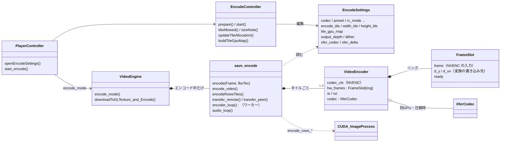
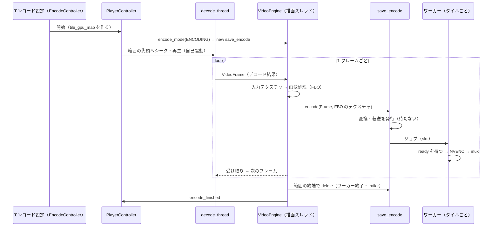
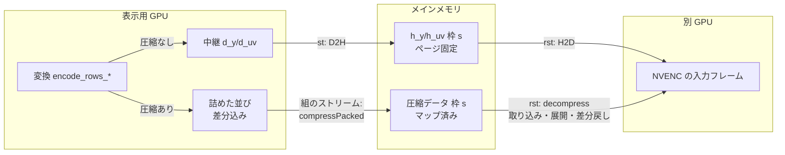

# エンコード（書き出し）のコア

画像処理を反映したフレーム（GL の FBO）を、NVENC で動画ファイルに書き出すまで。
1 GPU 1 タイル / 1 GPU マルチタイル / マルチ GPU（圧縮なし・圧縮あり）と 8bit / 10bit の組み合わせをすべて扱う。
入力側（デコード）は `DECODE_CORE.md`、圧縮転送（`XferCodec`）の中身は `DECODE_CORE.md` の 8.5 / 8.12（デコードと共用）、
設定画面は `QML_UI_CORE.md` の 4.7、入力の FBO（画像処理）は `IMG_PROCESS_CORE.md`、利用者向けの説明は `manual.html` の「動画の書き出し」。

## 1. 全体像



- 1 タイル = 1 本の NVENC ストリーム（`VideoEncoder`）。タイル分割すると 1 フレームを 2 / 4 / 8 本に分けて並列に書き出す。
- 変換（RGBA → NV12 / P010）は表示用 GPU で全タイルまとめて 1 回。別 GPU が受け持つタイルはその後で送る。
- NVENC への投入と書き込み（mux）はタイルごとのワーカースレッド。描画スレッドは変換と転送を発行するだけで待たない。

## 2. ファイル

| ファイル | 役割 |
|---|---|
| `src/qmlui/encodecontroller.*` / `qml/EncodePanel.qml` | 設定画面。タイル分割の可否、GPU の重みとタイルの割り振り、転送の圧縮 |
| `src/qmlui/playercontroller.cpp` | `openEncodeSettings` / `start_encode`（範囲の先頭へシーク → 自己駆動のデコード → 進捗） |
| `src/qmlui/videoengine.cpp` | `encode_mode`（`save_encode` の生成・破棄）、`downloadToGLTexture_and_Encode`（FBO を CUDA に見せて渡す） |
| `src/videoprocess/save_encode.*` | エンコーダ本体（初期化・変換・転送・ワーカー・音声・mux） |
| `cuda_kernels/encode_rows.cuh` / `encode_8bit.cu` / `encode_10bit.cu` | 変換カーネル（5 節） |
| `src/videoprocess/xfer_codec.*` / `cuda_kernels/xfer_compress.cu` | 圧縮転送（デコードと共用） |
| `src/main/__global__.h` | `EncodeSettings`、`encode_out_10bit`、`nvenc_surface_estimate` / `encode_ring_size`、`codec_max_bitrate` |
| `src/info/logfile_control.cpp` | ini（`Encodesetting/*`）の読み書き |

## 3. 開始から終了まで



- 書き出すのは**再生範囲（開始〜終了）**、**画像処理を反映した FBO**（表示ツールは入らない）。
- エンコード中はデコードの再生タイマーを切り、「1 枚受け取ったら 1 枚デコード」で進む（コマを落とさない）。
- `save_encode` のコンストラクタが例外を投げたら（VRAM 不足、エンコーダを開けない、出力ファイルを開けない等）`encode_error` でエラー表示して元に戻る。
  コンストラクタは本体 `init` を try で囲み、失敗したらスレッドを止めて `release_all(false)` で途中まで確保したもの（CUDA のメモリ・ストリーム・イベント、XferCodec、FFmpeg のコンテキスト）を全部返してから投げ直す。
  trailer は書かず、開いた出力ファイルは消す。音声スレッドとワーカーはヘッダを書き終えてから起動する（動いている `std::thread` を残して例外にすると `std::terminate`）。
- 途中の失敗（ディスクの空き不足・書き込みエラー・NVENC のエラー・転送や変換の失敗）は `save_encode::fail` が記録する（どのスレッドからでも、最初の 1 件）。
  以降の `encode_video` は何もしない。VideoEngine は毎フレーム `failed()` を見て、立っていたら `close()`（吐き切り → trailer）→ delete し、
  `encode_error`（「中断: …」）を出す（Widgets 版の GLWidget も同じ）。終わりの通知はエンコーダを閉じたときの 1 回だけ。
  VideoEngine 側の FBO の受け渡し（map・配列の取得・テクスチャの作成・unmap）の失敗も中断する（`abortEncode`。黙って戻ると毎コマ同じ失敗を繰り返して終わらない）。途中までのファイルは残す（MP4 / MOV は trailer を書けないと再生できないことがある）。
  開始前は、CBR / VBR なら目標ビットレート × 本数 × 長さで保存先の空き容量を見積もり、足りなければ開始しない（EncodeController::start。CQ / CQP は見ない）。
- CUDA API・nvCOMP の戻り値はエンコード中も全部見る（`save_encode::ck`、XferCodec の戻り値）。nvCOMP のチャンクごとの結果と展開後の大きさ、
  受け渡しのヘッダは GPU 上で検査して印を立て（`XferCodec::deviceError`、数フレーム遅れて分かる）、見つけたら中断する。
- VRAM 不足は開始時に出る（NVENC のフレーム・エンコーダ・転送の中継・XferCodec）。XferCodec は確保できなければ圧縮なしへ、
  メインメモリ経由の準備ができなければデバイス間コピーへ落とし、それ以外は例外（文言に「VRAM」を含める）→ 解放 → エラー表示。
- 終了は `save_encode::close()`（デストラクタも呼ぶ。ワーカーへ EOS → 吐き切り → 音声 flush → `release_all(true)`: trailer → 解放）。キャンセルでもファイルは正しく閉じる。

## 4. 出力の形

### 4.1 8bit / 10bit

| 入力（FBO） | コーデック × プロファイル | NVENC への入力 | 変換カーネル |
|---|---|---|---|
| RGBA8（8bit 経路。Widgets 版は常に） | すべて | NV12 | `encode_rows_rgba8_to_nv12` |
| RGBA16（10bit 経路） | H.264、または HEVC / AV1 の 8bit | NV12（ディザあり / なし） | `encode_rows_rgba16_to_nv12` |
| RGBA16（10bit 経路） | HEVC Main 10 / AV1 Main（10bit） | P010（値は上位 10bit） | `encode_rows_rgba16_to_p010` |

- 判定は `encode_out_10bit()`（設定画面と `save_encode` で共用）: 10bit 経路 × HEVC / AV1 × `output_depth = 10`。
- 色は BT.709 limited（デコードと同じ行列）。VUI にも BT.709 / limited を書く。HDR は非対応。
- ディザ（10bit → 8bit）は座標とチャンネルのハッシュで ±0.5 段階（フレーム間で同じ）。設定 `dither`。

### 4.2 大きさとタイル分割

- 書き出す大きさは**偶数に切り下げる**（4:2:0。奇数なら右端 1 列・下端 1 行を捨てる）。`save_encode` の `width_ / height_`
  が書き出す大きさ、`texW_ / texH_` が FBO の大きさ（テクスチャは元の大きさで読み、上下反転も元の高さで計算）。
  設定画面の情報欄に注記（`EncodeController::sizeNote`）。
- タイル分割（`encode_tile` = 1 / 2 / 4 / 8 → 1×1 / 2×1 / 2×2 / 4×2）は、1 タイルの幅・高さが偶数になり、かつ NVENC の上限
  （1 本 8192、H.264 は 4096）に収まるものだけ選べる（`EncodeController::tileAllowed`）。
  奇数になる分割を許すと NVENC が偶数に切り上げ、余った列が未初期化のまま入って色がにじむ（1366 の 2 分割 → 1368 幅になった）。
- タイルの並びは左上から行ごと（デコードと同じ）。1 ファイルに映像ストリームを並べるか、タイルごとに別ファイル（`separate_files`。
  `out.mp4` → `out.tile0.mp4` …、音声はタイル 0 だけ）。書き出したタイル分割のファイルはこのアプリの NVDEC 経路でそのまま開ける。

## 5. 1 フレームの流れ（save_encode::encode_video）

```
0) wait_slot_free     リングの slot を前に使ったフレームが NVENC から離れるまで待つ（全タイル）
1) 書き込み先         表示用 GPU のタイル: FrameSlot.d_y/d_uv = NVENC の入力フレームの面
2) 変換（st）         GL の描画完了を待つ → encode_rows_*（全タイルを 1 回で）→ [ev]
                      圧縮転送のタイルは XferCodec の詰めた並びへ（encodeRowsTiles）
3) ev を返す          呼び出し側は ev を待たせてから FBO を unmap する
4) 転送の発行         タイルごと（6 節）。最後に fs.ready を記録
5) ジョブの投入       submit_job → ワーカーが fs.ready を待って avcodec_send_frame → パケットを mux
```

### 5.1 変換（cuda_kernels/encode_rows.cuh。デコード側の decode_rows.cuh と対）

- 1 ブロック = 1 タイルの Y 2 行 ＋ UV 1 行、1 スレッド = 横 2 画素（テクスチャの 2×2 を読み、Y を 4 つと、その平均から U / V）。
  起動は grid = (タイルの高さ / 2, タイル数)。タイル数・8bit / 10bit によらず 1 回。
- タイルごとに書き方を切り替える（`NV12Tiles::packed`）。普段は NV12 / P010 の並び（P010 は `<<6`）。圧縮転送のタイルは
  XferCodec の詰めた並びへ値をそのまま（差分ありなら `xfer_fwd` と同じジグザグの差分）書く。左隣の値はワープ内シャッフル・
  共有メモリ・区間の繰り越しで受け取る。
- 色の計算は `encode_8bit.cu`（`luma_8bit` / `chroma_8bit`）と `encode_10bit.cu`（`nv12_luma_255` / `p010_luma` など）だけ。
- 行の先頭が 2 要素の境界に無いときは 1 要素ずつ書く。UV の行は確保した要素数を超えて書かない。

## 6. タイルの行き先（パターン）

| パターン | タイルの GPU | 変換の書き込み先 | 転送 | ready を記録するストリーム |
|---|---|---|---|---|
| 1 GPU・1 タイル / 1 GPU・マルチタイル | 表示用 | NVENC の入力フレーム | なし | `st`（表示用 GPU） |
| マルチ GPU・表示用 GPU のタイル | 表示用 | NVENC の入力フレーム | なし | `st` |
| マルチ GPU・別 GPU・圧縮なし | 別 | 中継 `d_y / d_uv`（表示用 GPU） | 2 段コピー（`transfer_remote`） | `rst`（別 GPU） |
| マルチ GPU・別 GPU・圧縮あり | 別 | XferCodec の詰めた並び（表示用 GPU） | 圧縮転送（`transfer_remote`） | `rst` |
| 準備に失敗（primary_ctx で開けない等） | 別 | 中継 `d_y / d_uv` | デバイス間コピー（`transfer_peer`。遅い） | `st` |

- タイルの割り振り: GPU ごとの重み（`GPUInfo::tile_weight`、0〜10）の比で按分（`updateTileAllocation`）。`tile_gpu_map` は
  表示用 GPU のタイルが先頭。AV1 に対応しない GPU は AV1 選択時に外す（`applyAv1Restriction`）。デコードの重み（`decode_weight`）とは別。

### 6.1 別 GPU への転送（save_encode::transfer_remote）



- 別 GPU のエンコーダは `primary_ctx=1` で開く（Runtime API と同じコンテキストにして、こちらのストリームから AVFrame へ書くため）。
- メインメモリの枠は 3 つ（`kXferStage`）をフレームごとに順に使う。PCIe は上り下りが独立なので、表示用 GPU の書き出しと
  別 GPU の読み込みは重なる。
- 同期の条件（壊さないため）

  | 再利用するもの | 待つもの |
  |---|---|
  | メインメモリの枠 s | 前回の読み込み完了 `h2d_ev[s]`（別 GPU） |
  | XferCodec の組（2 組を交互） | 変換の前に `nextTight` の `reuseDone`（組の前回の圧縮完了） |
  | 中継 `d_y / d_uv`、NVENC の入力フレーム | `wait_slot_free`（NVENC が参照を離すまで） |
  | ワーカーが NVENC へ渡す | `fs.ready`（別 GPU の `rst` の最後） |

- 圧縮するタイルは中継を確保しない。圧縮の設定は `xfer_codec` / `xfer_delta`（既定 ANS・差分あり。選択肢はデコード設定と共用）。
- 120 フレームごとにログ（`[save_encode] 圧縮転送 …`: 圧縮 / 送出 / 展開の ms（タイルの最大）、圧縮率）。

## 7. NVENC とリング

- `hw_frames_ctx`（`AV_PIX_FMT_CUDA`、sw_format = NV12 / P010）から `encodeRingSize` 枚を確保してリングにする。
- **不変条件 `encodeRingSize > nvenc_surfaces_`**（崩れるとデッドロック）。B フレームがあると NVENC は入力を抱えたまま出力しないので、
  こちらのリングが NVENC の入力プールより大きくなければ、NVENC が出力を始める前にこちらが空き待ちで止まる。
  - `b_frames_` = min(設定, 7, コーデックの上限 H.264 4 / HEVC 5 / AV1 7)
  - `async_depth_` = B フレームあり 1 / なし 4、`nvenc_surfaces_ = nvenc_surface_estimate()`、`encodeRingSize = encode_ring_size()`
    （式は `__global__.h`。設定画面の VRAM 見積もりと共用）
- slot の空きは「ワーカーが送り終えた（`submitted_to_worker`）」と「AVFrame の参照カウント」で判定する（出力順に依存しない）。
- ワーカー（`encoder_loop`）: ジョブを取る → `cudaEventSynchronize(fs.ready)` → `avcodec_send_frame`（EAGAIN ならパケットを回収して再試行）
  → パケットを `av_interleaved_write_frame`（1 ファイル構成ではロックを共有）。Windows ではスレッド優先度と MMCSS を固定
  （前面のウィンドウが変わると fps が落ちるため）。
- レート制御は `rc` を必ず明示（CBR / VBR / CQ / CQP）。ビットレートの設定値は常に「1 ストリームあたり」。

## 8. 音声

- 入力は `decode_thread::get_decode_audio`（エンコード中だけ `Frame.audio_pcm` を作る）。`save_encode::encode` がキューに積み、
  音声スレッド（`audio_loop`）が FIFO でコーデックのフレーム長にそろえてエンコードする。
- AAC / FLAC / PCM（16 / 24 / 32bit float）。コンテナに入らない組み合わせは UI が出さない（MOV に FLAC は AAC に落とす）。ゲインは float のうちに掛ける。
- 音声を含めない設定、または素材に音声が無いときは音声ストリーム自体を作らない。

## 9. 設定（ini `Encodesetting/*`）

| 項目 | キー |
|---|---|
| 保存先・コンテナ・別ファイル | `encode_path` / `container` / `separate_files` |
| コーデック・プロファイル（深さ）・ディザ | `codec` / `output_depth` / `dither` |
| プリセット・チューニング・B フレーム・GOP | `preset` / `tune` / `b_frames` / `gop_size` |
| レート制御・ビットレート | `rc_mode` / `pass_mode` / `target_bit_rate` / `max_bit_rate` / `cq` / `bitrate_basis` |
| タイル分割・分割エンコード | `encode_tile` / `split_encode_mode` |
| 音声 | `audio_enable` / `audio_codec` / `audio_bitrate` / `audio_gain_db` |
| 別 GPU への転送の圧縮 | `xfer_codec`（`none` / `ans` / `bitcomp` / `cascaded`、既定 `ans`）/ `xfer_delta`（既定 true） |

GPU ごとの重みは ini の GPU グループ（`tile_weight`）。

## 10. 実測（RTX 5000 Ada ×4、Gen4 x16、16K 8bit、転送を消した上限は 120fps）

| 別 GPU への転送 | fps |
|---|---|
| デバイスをまたぐ `cudaMemcpy2DAsync`（以前） | 64 |
| 2 段コピー（圧縮なし） | 85 |
| ANS・差分あり（変換と前処理が別 / 統合） | 113 / 113 |
| Bitcomp・差分あり（変換と前処理が別 / 統合） | 104 / 116 |

- 圧縮は表示用 GPU で行う。ANS は圧縮そのものが重く、前処理の統合が効かない。Bitcomp は圧縮が軽いので統合の効果がそのまま出た。
  既定は ANS（PCIe が細い構成でも安全）。
- ANS で圧縮 0.9ms / 送出 0.84ms / 展開 1.05ms・圧縮率 7〜9。転送はネックではなく、残りは表示用 GPU の負荷。
- 10bit（P010）も圧縮転送を通して 10bit の段が残ることを確認済み（ramp10 系のテスト素材）。
- 奇数サイズ（1365×767 → 1364×766）で、右端の列・下端の行が除かれ、内側の色に漏れが無いことを確認済み。

## 11. Widgets 版（MainWindow / GLWidget）との違い

- 入力は常に RGBA8（`save_encode(h, w)`、`srcRgba16 = false`）なので NV12 だけ。設定画面は別（タイル分割の偶数チェックは無いので、
  奇数になる分割ではログに警告が出る）。`save_encode` 以下は共通。
