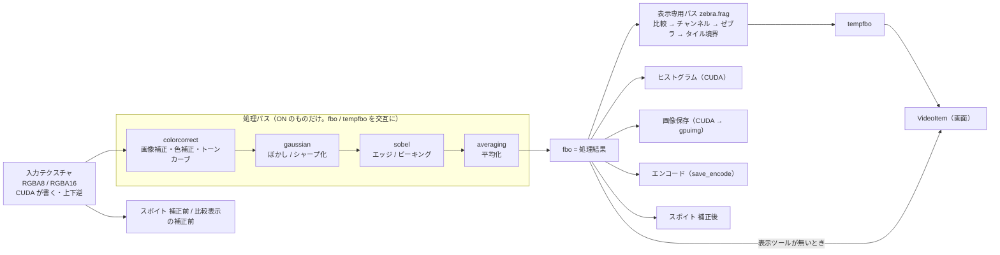
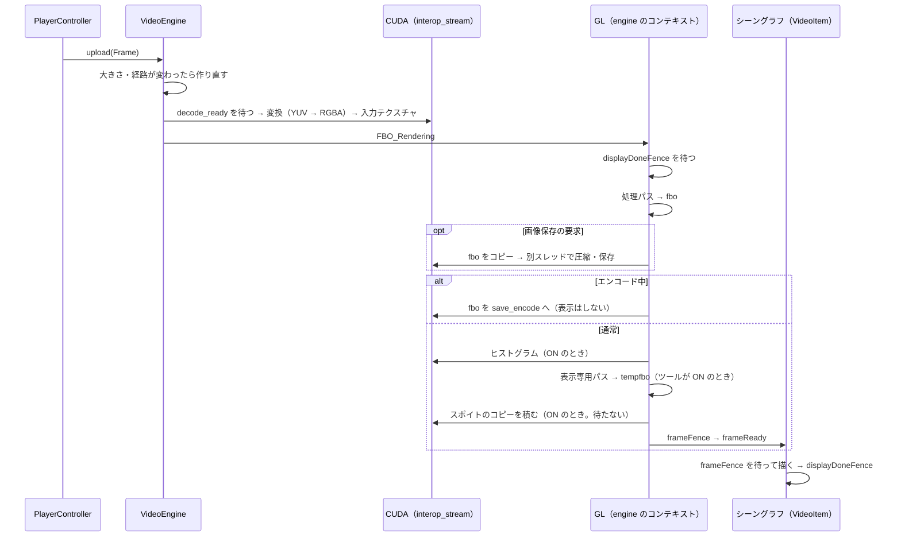

# 画像処理のコア（VideoEngine）

デコード結果が入力テクスチャに書かれてから、画像処理・表示ツール・ヒストグラム・スポイト・画像保存・エンコードへの受け渡しまで。
QML 版（`--qml`）の `VideoEngine` を中心に書く（Widgets 版 `GLWidget` は 15 節）。
入力テクスチャに書くまで（デコードと YUV → RGBA）は `DECODE_CORE.md`、エンコードは `ENCODE_CORE.md`、
画面（パネル・操作・設定の UI）は `QML_UI_CORE.md`。

## 1. 全体像

- **処理パス**（画像処理タブ）は映像そのものを変える。結果の `fbo` をヒストグラム・画像保存・エンコードが読む。
- **表示専用パス**（表示ツールタブ）は `fbo` を読んで `tempfbo` に描くだけ。`fbo` は変えないので、ヒストグラム・画像保存・エンコードには入らない。
- 表示は `VideoEngine::displayTexture()`（表示ツールがあれば `tempTexture`、なければ `fbo`）を `VideoItem` がそのまま載せる（コピーしない）。

## 2. ファイル

| ファイル | 役割 |
|---|---|
| `src/qmlui/videoengine.*` | GL コンテキスト・テクスチャ・FBO、`upload`、`FBO_Rendering`、uniform の設定、ヒストグラム、スポイト、画像保存、エンコードへの受け渡し |
| `shaders/colorcorrect.frag` | 画像補正・色補正・トーンカーブ（1 パス） |
| `shaders/gaussian.frag` / `sobel.frag` / `averaging.frag`（＋ `*.vert`） | 畳み込み系の処理パス |
| `shaders/zebra.frag` | 表示専用パス（比較・チャンネル・ゼブラ・タイル境界）。名前に反してこの 4 つ全部 |

- シェーダは**実行時にファイルから読む**（`VideoEngine::initialize`。作業フォルダからの相対パス `../project/shaders/*`）。
  `.frag` を書き換えたらビルドは要らず、起動し直せば反映される。逆に、作業フォルダが変わると読めずに初期化が失敗する。
  colorcorrect / zebra は頂点シェーダに `averaging.vert` を使う。リンクは `Sobel_program` などの `QOpenGLShaderProgram`、
  描画で使う id と uniform の場所は `shader` 構造体（`Sobel_shader` …）と `cl_` / `xl_` に取ってある。
| `src/qmlui/filterkernel.*` | ガウシアン / 平均化の係数（サイズ・σ・正規化・直接編集） |
| `src/qmlui/tonecurve.*` | トーンカーブの点 ⇔ 文字列 ⇔ 256 段の表（単調 3 次補間） |
| `src/qmlui/playercontroller.*` | QML からの設定変更（`setFilterParam` ほか）→ `g_AppSettings` → `filter_change_flag` |
| `src/qmlui/videoitem.*` | `VideoItem` / `HistogramItem`（テクスチャをシーングラフへ） |
| `src/qmlui/perfmeter.*` | 段ごとの時間（性能 HUD） |
| `src/imageprocess/cuda_imageprocess.*` | CUDA カーネルの起動口（ヒストグラム・画像保存の変換など） |
| `cuda_kernels/histogram_8bit.cu` / `histogram_10bit.cu` | ヒストグラムの集計・統計・正規化 |
| `cuda_kernels/encode_10bit.cu` | `rgba16_to_rgba8_tex`（10bit 経路の画像保存を 8bit にする） |
| `src/main/__global__.h` | `AppSettings`（画像処理・表示ツールの設定はすべてここ。ini の `[Filter]`） |
| `src/info/logfile_control.cpp` | ini の読み書き |

## 3. GL / CUDA の資源

### 3.1 コンテキストとスレッド

- `VideoEngine` は自前の `QOpenGLContext` ＋ `QOffscreenSurface` を GUI スレッドで持つ。Qt Quick とは `AA_ShareOpenGLContexts` で共有し、
  ここで描いたテクスチャを `VideoItem` / `HistogramItem` が `QSGOpenGLTexture::fromNative` で包んで表示する。
- render loop は `basic`（GUI スレッド）固定（`main.cpp` が `QSG_RENDER_LOOP=basic`）。CPU 側の競合は無く、GPU 側の順序だけフェンスで渡す。
  - engine → QML: 描き終えたら `frameFence`（`publishFrameFence`）。`VideoItem` が描く前に `glWaitSync`（`waitFrameFence`）。
  - QML → engine: シーングラフが描き終えたら `displayDoneFence`（`signalDisplayDone`）。次の FBO 上書きの前に待つ（`waitDisplayDone`）。
- CUDA は `interop_stream`（変換・画像保存のコピー）、ヒストグラムは既定ストリーム ＋ `hist_stream`。

### 3.2 テクスチャと登録

| 資源 | 形式 | CUDA の登録 | 用途 |
|---|---|---|---|
| `inputTextureID` | RGBA8 / RGBA16 | `cudaResource1`（SurfaceLoadStore） | 変換カーネルが surface で書く。比較表示・スポイトの「補正前」 |
| `fbo` / `fboTextureID` | 同じ | `cudaResource2`（ReadOnly）、`cudaResource_screenshot`（ReadOnly） | 処理結果。ヒストグラム・画像保存・エンコード・スポイト「補正後」 |
| `tempfbo` / `tempTextureID` | 同じ | — | 処理パスのピンポン、表示専用パスの出力 |
| `curveTexID` | 1D、RGB32F × 256 | — | トーンカーブの表（ユニット 2） |
| `vbo_hist` | 頂点バッファ | `cudaResource_hist_draw`（WriteDiscard） | ヒストグラムの線（CUDA が書く） |
| `histFbo` | RGBA8 | — | ヒストグラムのプロット（`HistogramItem` が表示） |
| `d_cudaScreenshot` | `cudaMallocPitch`、4 / 8 バイト/画素 | — | 画像保存のコピー先 |

- 形式は経路で決まる（8bit 経路 RGBA8、10bit 経路 RGBA16。4.1）。大きさか経路が変わると `upload` が全部作り直す
  （`initCudaTexture` / `initTextureCuda` / `initCudaScreenshot` / `setShaderUniform` / `initCudaHist`）。
- CUDA のテクスチャ / surface オブジェクトは、使い終わる前に消さないよう「退役リング」（`inputSurfRetire` / `fboTexRetire` / `histTexRetire`）で
  ストリームの完了を待ってから破棄する。
- GPU 上で同時に処理中のフレームは 2 まで（`kMaxFramesInFlight`。`frameDone` イベント）。

## 4. 1 フレームの流れ

- 一時停止中に設定を変えたときは `rerender`（入力テクスチャはそのままで `FBO_Rendering` だけ）。
- 設定の反映: QML → `PlayerController::setFilterParam` などが `g_AppSettings` を書き換え、`engine_->filter_change_flag = true`。
  次の `FBO_Rendering` の先頭で `setShaderUniformEnable()` が全 uniform を送り直す。係数は `kernel_change_flag` → `uploadKernels()`。

### 4.1 8bit / 10bit の経路

| | 8bit 経路 | 10bit 経路 |
|---|---|---|
| 選ばれる素材 | 8bit 素材（Widgets 版は常に） | 9bit 以上（NVDEC の P010、CPU デコードの 10bit プレーン。`wantsRgba16`） |
| テクスチャ・FBO | RGBA8 | RGBA16 |
| シェーダ | 共通（float で読み書き。0..1） | 同じ |
| ヒストグラム | 256 段（`histogram_8bit.cu`） | 1024 段（`histogram_10bit.cu`、`HistData10`） |
| スポイト | 0..255 | 0..1023（RGBA16 を四捨五入） |
| 画像保存 | 8bit | PNG / TIFF は設定で 16bit（10bit の値を 16bit に広げる）か 8bit。JPEG / BMP は 8bit |
| エンコード | NV12 | NV12（ディザ）/ P010（`ENCODE_CORE.md` 4.1） |

- 経路は素材ごとに自動で切り替わる（`VideoEngine::rgba16_`）。処理の深さは動画情報の Process/Render Depth の前側（16bit / 8bit）。
- 10bit → 8bit に落とす所（画像保存の 8bit、エンコードの NV12）は、座標とチャンネルのハッシュで ±0.5 段階のディザを足せる
  （フレーム間で同じノイズ。設定 `screenshot_dither` / `EncodeSettings::dither`、既定あり）。

## 5. 処理パス（FBO_Rendering）

- 順番は固定: `colorcorrect` → `gaussian` → `sobel` → `averaging`（ON のものだけ）。全部 OFF なら `averaging` を `u_filterEnabled = 0` で 1 回（素通し）。
  色の補正を先にするのは、補正後の画でエッジ・ぼかしを見るため。
- `fbo` と `tempfbo` を交互に使い、**最後のパスが必ず `fbo` に着地する**よう、パス数の偶奇で開始側を決める。
- **上下反転は 1 パス目だけ**（`vao`。CUDA が書いた入力は上下逆）。2 パス目以降は `vaoNoFlip` で、`texelSize.y` の符号を反転して
  「カーネルの上の行」が常に画像の上を指すようにする。全パスで反転するとパス数が偶数のとき逆さまになる。
- 値は 0..1 の float。各パスの最後で 0..1 に収める。

### 5.1 colorcorrect.frag（画像補正・色補正・トーンカーブ）

| 段 | 計算（c は RGB、y は Rec.709 の輝度） | 有効条件 |
|---|---|---|
| 明るさ | c + brightness（±0.5） | 画像補正（`colorEnabled`） |
| コントラスト | (c − 0.5) × contrast + 0.5（0..2 倍） | 同 |
| シャドウ / ハイライト | c + (shadows × ws + highlights × wh) × 0.35。ws = 1 − smoothstep(0, 0.5, y)、wh = smoothstep(0.5, 1, y) | 同 |
| ガンマ | c^(1 / gamma) | 同 |
| 色温度・ティント・ゲイン・オフセット | c × wb × gain + offset。wb は色温度・ティントから作った R/G/B の倍率を輝度で割ったもの（明るさを保つ） | 色補正（`rgbEnabled`） |
| R/G/B ガンマ | c^(1 / rgbGamma) | 同 |
| 彩度 | mix(y, c, saturation)（0 = 白黒、2 = 2 倍） | 同 |
| トーンカーブ | 1D テクスチャ（256 段、線形補間）をチャンネルごとに引く。テクセル中心 (c × 255 + 0.5) / 256 で読む | `curveEnabled` |

- トーンカーブの表は `setShaderUniformEnable` が作る: RGB 全体のカーブ（master）を先に引き、その値で各チャンネルのカーブを線形補間して引いた
  合成済みの 256 × RGB（`GL_RGB32F`）。

### 5.2 gaussian.frag（ぼかし / シャープ化）

- 係数 `u_kernel[81]`（行優先 (2r+1)²、正規化済み）と半径 `u_radius`。QML 版は常に係数を渡す（`u_radius = 0` は Widgets 版の固定 7×7）。
- `u_mode = 1`（シャープ化）: アンシャープマスク `orig + amount × (orig − blur)`（amount = `sharpen_amount` / 100、0..5）。

### 5.3 sobel.frag（エッジ / ピーキング）

- 3×3 の Sobel。明るさは `dot(rgb, (0.299, 0.587, 0.114))`（`u_mode = 0` の Widgets 互換は R）。強さ = √(gx² + gy²)。
- `u_mode`: 1 = エッジのみ（白黒）、2 = ピーキング（元の画素に、しきい値を超えた輪郭だけ色を重ねる。
  濃さ t = clamp((強さ − しきい値) × 4 + 0.35, 0, 1)）。QML の `sobel_mode`（0 / 1）を 1 / 2 にして渡す。

### 5.4 averaging.frag（平均化）

- gaussian と同じ係数の仕組み（`FilterKernel` の Box）。全部 OFF のときの素通しもこのシェーダ。

## 6. 設定と uniform の対応

QML の書き込み口は 3 種類: ON/OFF は `player.<名前>`（`gaussian` / `sobel` …）、値は `player.setFilterParam(key, v)`、
トーンカーブは `player.setCurvePoints(ch, pts)`、係数は `player.gaussianKernel` / `averagingKernel`（`FilterKernel`）。

| 機能 | ON/OFF（`g_AppSettings`） | 値（setFilterParam のキー → `g_AppSettings`） | シェーダの uniform（変換） |
|---|---|---|---|
| 画像補正 | `colorEnabled` | brightness / contrast / shadows / highlights（-100..100）、gamma100（10..300） | `u_brightness` = /200、`u_contrast` = 1 + /100、`u_shadows` / `u_highlights` = /100、`u_gamma` = /100 |
| 色補正 | `rgbEnabled` | temperature / tint（-100..100）、saturation（0..200）、gainR/G/B（0..200）、offsetR/G/B（-100..100）、gammaR/G/B（10..300） | `u_wb`（色温度 t・ティント m から (1+0.25t, 1−0.25m, 1−0.25t) を輝度で割る）、`u_gain` = /100、`u_offset` = /200、`u_rgbGamma` = /100、`u_saturation` = /100 |
| トーンカーブ | `curveEnabled` | `curve_pts[0..3]`（"入力:出力,..."。0 = RGB、1..3 = R/G/B） | `u_curve`（1D テクスチャ、ユニット 2） |
| ガウシアン | `gaussianfilterEnabled` | gaussianMode（0 / 1）、sharpenAmount（0..500）。係数は `FilterKernel` | `u_mode`、`u_amount` = /100、`u_radius` / `u_kernel` |
| ソーベル | `sobelfilterEnabled` | sobelMode（0 / 1）、peakingThreshold（0..100）、peakingColor（0..4） | `u_mode` = 1 / 2、`u_threshold` = /100、`u_peakColor`（赤・緑・青・黄・白） |
| 平均化 | `averagingfilterEnabled` | 係数は `FilterKernel` | `u_radius` / `u_kernel` |
| 比較表示 | `compareEnabled` | compareDir（0 左右 / 1 上下）、comparePos（0..1000） | `u_compareOn` / `u_compareDir` / `u_comparePos` = /1000 |
| チャンネル | `channelEnabled` | channelMode（0 R / 1 G / 2 B / 3 輝度） | `u_channel`（OFF は -1） |
| ゼブラ | `zebraEnabled` | zebraHighOn / zebraHighLevel、zebraLowOn / zebraLowLevel（輝度 %） | `u_highOn` / `u_high` = /100、`u_lowOn` / `u_low` = /100 |
| タイル境界 | `seamEnabled` | seamGrid、seamHighlight、seamThreshold（1..64、8bit 階調）、seamGridColor、seamHighlightColor | `u_seamOn`、`u_seamThr` = /255、`u_seamColor`（線は QML 側） |
| スポイト | `eyedropperEnabled` | eyedropperMode（0 補正後 / 1 補正前 / 2 両方） | —（10 節） |

- ini は `[Filter]` セクション（`logfile_control.cpp`。キーは `g_AppSettings` の名前とほぼ同じ。R/G/B は `rgb_gain_0..2` など、
  トーンカーブは `curve_master` / `curve_r` / `curve_g` / `curve_b`）。終了時に保存。係数の直接編集だけは保存しない（サイズ・σ・正規化は残る）。
- 画面サイズに比例させる値（ゼブラの縞の幅、比較の線の太さ、タイル境界の帯の幅）は `FBO_Rendering` で毎フレーム渡す。

## 7. 係数とトーンカーブ

### 7.1 FilterKernel（`filterkernel.*`）

- ガウシアン（`Kind::Gaussian`）と平均化（`Kind::Box`）で 1 つずつ（`player.gaussianKernel` / `averagingKernel`）。
- サイズ 3 / 5 / 7 / 9 と σ（ガウシアンのみ）から係数を作る。セルを直接書き換えると `custom = true`（ini には保存しない）。
  正規化 ON ならシェーダには合計で割った値を渡す。サイズ・σ の変更とリセットで作り直す。
- `changed()` → `PlayerController` が `VideoEngine::setFilterKernel` → `kernel_change_flag` → 次の描画で `uploadKernels()`。

### 7.2 ToneCurve（`tonecurve.*`）

- 点は 0..255 の整数（x = 入力、y = 出力）、両端を必ず持つ、最大 16 点。点の間は単調 3 次補間（Fritsch–Carlson）で波打たない。
- 文字列 "0:0,64:52,255:255" ⇔ 点（壊れていれば直線、範囲外は収め、x で並べ替え、同じ x はまとめる）⇔ 256 段の表。
- UI の描画（`curveLut`）とシェーダの表（5.1）で同じ関数を使う。

## 8. 表示専用パス（zebra.frag）

`fbo` を読んで `tempfbo` に描く 1 パス。適用順は次のとおりで、どれか 1 つでも ON なら通る。

1. **比較表示**: 境目の片側に補正前（入力テクスチャ、ユニット 1。上下逆なので v を反転して読む）を出し、境目に白線。
   境目の位置は画面上のドラッグで変える（QML 側。0.1% 単位）。
2. **チャンネル表示**: R / G / B / 輝度のどれかを白黒で。
3. **ゼブラ**: 輝度（Rec.709、チャンネル表示の前の色）が上限以上 → 黒の斜め縞、下限以下 → 青の斜め縞。縞の幅は映像の高さに比例（8K で約 40px）。
4. **タイル境界の段差**: 境界をまたぐ差が、両側の内側の差より不自然に大きい所を色で強調（補正前で判定するのでフィルタの影響を受けない。
   境界に沿って前後 2 画素の平均でノイズを抑える）。タイル分割の動画（`width_scale × height_scale > 1`）で、大きさがタイル数で割り切れるときだけ。

- **画面上の重ね表示（QML。映像には描かない）**: タイルの境界線とタイル番号（`Main.qml` の `tileGrid`）、拡大時の画素グリッド（`pixGrid`）、
  スポイトの枠と値（`eye`）、比較の「補正前 / 補正後」のラベルとドラッグ（`cmpLabels`）。

## 9. ヒストグラム

- `histgram_flag` が ON のとき、表示モードの毎フレーム（エンコード中は動かない）。
- 集計: `fbo` をテクスチャとして CUDA で読む（`calc_histgram` / `calc_histgram_rgba16`。8bit 経路 256 段、10bit 経路 1024 段）
  → 統計（`histogram_status*`: 最小・最大・平均・縦軸の最大）を `hist_stream` でホストへ（同期する）
  → 正規化した線の頂点を `vbo_hist` へ（`histgram_normalize*`）。
- 描画: `drawHistogram` が `histFbo` にグリッドと RGB の線を描く（透明背景・premultiplied）。背景・目盛りの数字は QML（`HistogramPanel`）。
  大きさは表示側に合わせる（`setHistViewport`、上限 4096）。
- 値は `player.histogram`（`histStats()`。統計は 8bit 経路 0..255 / 10bit 経路 0..1023、`bins` = 256 / 1024）。
- 集計は同期するので、性能 HUD の「ヒストグラム」は CPU の実時間で測る。

## 10. スポイト

- `eyedropperEnabled` のとき、QML がマウス位置を `player.pickPixel(nx, ny)`（映像に対する 0..1）で渡す → `setPickRequest`。
- 描画したフレームごとに、その位置の 1 画素を **補正後**（`fbo`。GL の向きなので下から数える）と **補正前**（入力テクスチャ。上から数える）から
  ピン留めしたホストメモリへ `cudaMemcpy2DFromArrayAsync` で積み、イベントで完了を確かめる（`pickIssue` / `pickCollect`。CPU は待たない）。
- 結果には「どのフレームの値か」を付けて `pickUpdated` → `player.pick`。10bit 経路は RGBA16 を 0..1023 に四捨五入して返す（`bits: 10`）。

## 11. 画像保存

- `player.screenshot()` → `screenshot_flag` → 次の `FBO_Rendering` の処理パスの後で `doScreenshot`（表示ツールは入らない）。
- `fbo` を `d_cudaScreenshot` へコピー（`interop_stream`）→ スレッドプールで `gpuimg::Encoder::save`（GPU で圧縮。上下反転して保存）。
  保存中に次の要求が来たら見送る（`screenshotSaving`）。終わったら `screenshot_finished`。
- 形式: PNG / TIFF / JPEG / BMP（`ScreenshotSettings`、ini `[Screenshot]`）。
  - 10bit 経路の PNG / TIFF は `screenshot_depth = "16"` なら RGBA16 のまま 16bit で保存（`gpuimg::Image::rgba16`）。
  - それ以外（JPEG / BMP、8bit を選んだ PNG / TIFF）は `rgba16_to_rgba8_tex` で 8bit に四捨五入（`screenshot_dither` でディザ）。
- 保存先は `saveScreenshot_folder`（無ければホーム）。

## 12. エンコードへの受け渡し

- エンコード中は `FBO_Rendering` が処理パスの後で `downloadToGLTexture_and_Encode` を呼んで戻る（ヒストグラム・表示専用パス・スポイトは動かない）。
- `fbo` を `cudaResource2` で CUDA に見せ、GL の完了イベントと一緒に `save_encode::encode` へ。変換完了のイベントを `interop_stream` に
  待たせてから unmap する。続きは `ENCODE_CORE.md`。

## 13. 性能計測のフック（PerfMeter）

| 段 | 測る場所 | 方法 |
|---|---|---|
| 変換 | `upload` の変換カーネルの前後 | `interop_stream` の CUDA イベント |
| 画像処理 | 処理パスの前後（`FilterBegin` / `FilterEnd`） | GL のタイムスタンプ（`glQueryCounter`） |
| 表示ツール | 表示専用パスの前後（`DisplayBegin` / `DisplayEnd`） | 同上 |
| ヒストグラム | 集計 ＋ 描画 | CPU の実時間 |
| 描画スレッド | `upload` 全体 | CPU の実時間 |
| 受け取り間隔 | `upload` の先頭どうし（`PerfMeter::frameBegin`） | CPU の実時間 |
| 表示間隔・upload→表示・出なかったコマ | 画面に出たフレーム（下記） | CPU の実時間（frameSwapped の時刻） |

HUD が OFF の間は各フックが即 return する（クエリもイベントも出さない）。値の意味は `QML_UI_CORE.md` の 4.4。

### 13.1 表示の計測（画面に出たフレーム）

- upload したフレームが画面に出るとは限らない。`fbo` は 1 枚なので、シーングラフが swap する前に次の `upload` が来ると
  前のフレームは出ないまま上書きされる（`waitDisplayDone` は前回表示した分しか待たない）。受け取り間隔だけ見ても分からないので、
  画面に出た側で測る。
- 流れ: `FBO_Rendering` の最後で描いたフレームを `rendered_` に控える（通し番号・FrameNo・upload の時刻）
  → `VideoItem::updatePaintNode` が `notePainted`（`painted_`）→ swap → `QQuickWindow::frameSwapped`（`main.cpp`）が `onFrameSwapped`。
  `painted_` が前に出たものと違えば「出た」として、表示間隔・upload→表示・番号の差・その間の上書き枚数を `PerfMeter::addPresent` へ。
  同じフレームの描き直し（UI だけの更新・ズーム）は数えない。
- 上書きは `FBO_Rendering` で数える（前に描いたフレームが描かれも出もしていないうちに次を描いた）。
- 数えるのは安定して順方向に再生している間だけ（`setSteadyPlayback`。PlayerController の `render_active_ && !reverse_flag`）。
  それ以外の間は起点を捨てるので、一時停止・シークの明けの長い間隔は入らない（受け取り間隔も同じく `resetTiming`）。
- 時刻は swap が戻った時刻（vsync で戻る）。ドライバがフリップを溜める場合は実際の表示はそれより後になりうるが、間隔のばらつきを見るには足りる。
- CSV: 環境変数 `CUDA_VIEWER_PRESENT_LOG=<パス>` で 1 表示 1 行（HUD の ON/OFF と無関係。`steady` 列で再生中か分かる）。
  列は `t_ms, frame_no, step, present_interval_ms, upload_interval_ms, upload_to_present_ms, overwritten, steady,
  tick_interval_ms, tick_to_begin_ms, decode_ms, emit_to_recv_ms, recv_to_upload_ms, vblank_idx, vblank_step, swap_phase, refresh_ms, paced`。
  `paced` = 表示のペース（`DECODE_CORE.md` 3.6）を通ったコマ。待ち行列で待った時間は `recv_to_upload_ms` に入る。
  続けて `swaps, swap_ms, swap_max_ms, wake_late_ms, pend_waits`:
  `swaps` = 前のコマが出てからこのコマが出るまでの swap の回数（1 が理想。2 以上は同じ内容を描き直している）、
  `swap_ms` = このコマの swap にかかった時間（`afterRendering` → `frameSwapped`。swap がブロックしていないか）、
  `swap_max_ms` = その間の swap で一番長かったもの、`wake_late_ms` = 表示のペースのタイマーが予定より遅れた時間（swap 待ちの延長を含む）、
  `pend_waits` = 前のコマの swap 待ちで 1ms 延ばした回数、`dropped` = このコマを出す前に同じ vblank に重なって upload せず捨てたコマの数
  （リフレッシュより速い再生。`step` = 前に出たコマとの番号の差と合わせて見る）、`vb_src` = vblank の出どころ
  （1 = ウィンドウがあるモニターを測った値（`VblankClock`）、0 = DWM（画面全体）、-1 = なし）。`swap_phase` / `vblank_step` / `refresh_ms` もこの値で計算する。
  - 受け渡しの内訳: 刻み（`fps_thread` が `g_last_tick_ns` に記録）→ デコード開始（`processFrame`）→ 送出（`stamp_frame_times`）
    → GUI の受け取り（`decode_view` の先頭）→ upload の先頭。時刻は `VideoFrame::t_*`（`mono_now_ns`。QPC の ns でスレッドをまたいで比べられる）。
    `tick_interval_ms` は前に出たフレームの刻みとの差。受け取り待ち（`drop_flag`）で遅れたデコードは `tick_to_begin_ms` に出る。
  - 実際の vblank: `DwmGetCompositionTimingInfo`（`qpcVBlank`・`qpcRefreshPeriod`・`cRefresh`）から、swap の後の最初の vblank の番号
    （`vblank_idx`。時刻の差から数える。DWM の `cRefresh` は `qpcVBlank` と食い違うことがあったので使わない）、
    前のフレームとの差（`vblank_step`。29.97fps を 120Hz で出すなら 4 が正常で、約 10 秒に 1 回 5）、swap がリフレッシュ周期のどこで
    起きたか（`swap_phase` 0..1。1 に近いほど vblank の直前でぎりぎり）。ウィンドウ表示では swap は vblank を待たずに戻り、DWM が次の vblank で
    合成するので、frameSwapped の時刻だけでは実際に出た vblank が分からないため。DWM の遅れが一定という前提の値。
  `upload_interval_ms`（そのフレームの upload の間隔）と `present_interval_ms` を並べると、ばらつきがデコード・受け取り側か表示側かを切り分けられる。
- 実測（2026-11、4K 29.97fps・59.94Hz、HUD と動画情報を表示）: Canvas 版の推移グラフでは表示間隔が vblank 2 回以外になったのが 9.1%
  （σ 4.5ms）、乱れは性能 HUD の更新（250ms）の周期にそろっていた（upload→表示が 6ms → 15〜20ms に伸びて次の vblank へ押し出される）。
  推移グラフを C++ の `SparklineItem` に置き換えた。
- 実測（同じ素材、120Hz のモニター。上の 59.94Hz は誤りで、実際の vblank で数え直した）: 推移グラフを置き換えた後も、4 vblank 以外が約 10%。
  `swap_phase` が 0〜1 に一様（刻みと vblank がずれていく）で、境目を通る 1〜2 秒のあいだ 5・3 が交互に出ていた。
  さらに 29 コマごと（キーフレーム）に `decode_ms` が 3.4〜5.3ms。表示を vblank に合わせる（`DECODE_CORE.md` 3.6）ようにした。

## 14. 画像処理を 1 つ足す手順

1. **設定**: `AppSettings`（`__global__.h`）に ON/OFF と値を足す。`logfile_control.cpp` の `[Filter]` に読み書きを足す。
2. **シェーダ**: 処理パスなら `shaders/` に `.frag` を足し、`VideoEngine::initialize` で読み込んで `shader` を作る（パスは 2 節の注意どおり）。
   `FBO_Rendering` のパスの並びに足す（`passes[]` の大きさも）。表示専用なら `zebra.frag` に足す（`fbo` を変えないこと）。
   uniform の場所は初期化で取り、`setShaderUniformEnable` で値を送る（画面サイズに比例する値は `FBO_Rendering` で）。
3. **QML との窓口**: `PlayerController` に ON/OFF の `Q_PROPERTY`（`filterChanged`）を足し、値は `setFilterParam` / `filterParams` のキーに足す。
   変更したら `engine_->filter_change_flag = true`。`allFiltersOff` にも足す。
4. **UI**: `qml/` に `XxxParams.qml` を作り `FilterPanel` のタブに置く。`qml.qrc` と `qml/qmldir` に登録して qmake（`QML_UI_CORE.md` の 1 節）。
5. **確認**: 8bit / 10bit の両方の素材、パス数の偶奇（上下が逆にならないか）、ヒストグラム・画像保存・エンコードに入るか（表示専用なら入らないか）。
6. **資料**: この資料の 5 / 6 / 8 節と `manual.html` の「画像処理」。

## 15. Widgets 版（GLWidget）との違い

- 常に 8bit 経路。処理パスは ガウシアン / ソーベル / 平均化 の 3 つ（固定 7×7 のカーネル、`u_radius = 0`、ソーベルは `u_mode = 0`）。
  画像補正・色補正・トーンカーブ・表示ツールは無い。
- 上下反転を 1 パス目だけにする修正は同じ。
