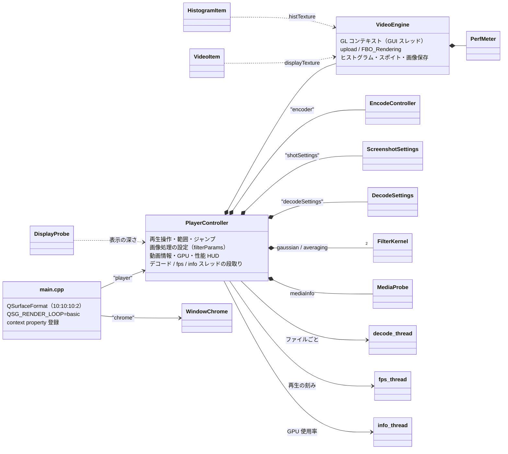
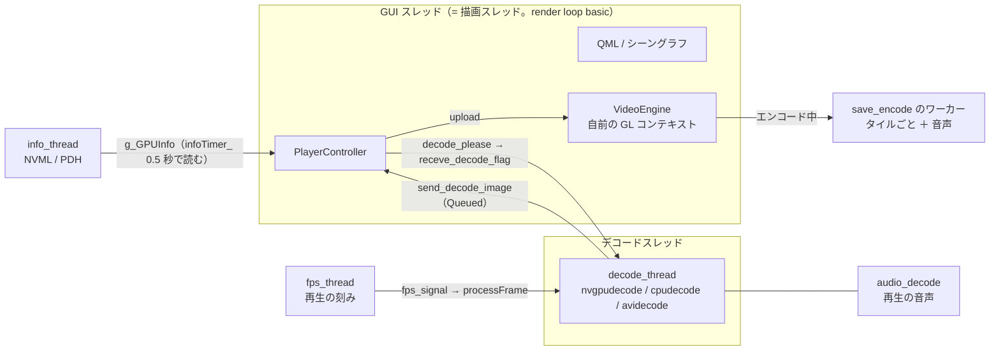

# QML 版 UI のコア

CUDA + OpenGL + FFmpeg による GPU 専用の 8K / 16K タイル動画ビューア・エンコーダ（Qt 6.9）の、Qt Quick 版 UI（`--qml`）。
UI のクラス構成・スレッド・QML と C++ の約束ごと・画面ごとの実装・表示の 10bit・機能を足す手順・注意点をまとめる。
細部は各ファイル先頭のコメント（現状に合わせて更新済み）。

資料の一覧（`docs/`）

| 資料 | 内容 |
|---|---|
| `QML_UI_CORE.md`（これ） | UI: 構成・スレッド・QML と C++ の窓口・画面・表示の 10bit・手順・注意点 |
| `IMG_PROCESS_CORE.md` | 画像処理: VideoEngine の GL / CUDA 資源、処理パスと各シェーダの計算、表示ツール、ヒストグラム、スポイト、画像保存 |
| `DECODE_CORE.md` | デコード: デコーダの選択、スレッドと受け渡し、AVI / CPU / NVDEC（1 タイル・マルチタイル・マルチ GPU）、YUV → RGBA。8 節がマルチ GPU デコードの詳細 |
| `ENCODE_CORE.md` | 書き出し: 出力の形、大きさとタイル分割、1 フレームの流れ、別 GPU への転送、NVENC とリング、音声 |
| `manual.html` | 利用者向けの操作マニュアル |

---

## 1. 起動とビルド

- `--qml` 引数、または環境変数 `CUDA_VIEWER_UI=qml` で Qt Quick 版。なしなら従来の Widgets 版（`MainWindow` / `GLWidget`）。
- ファイルを追加・削除したら **qmake を実行してから再ビルド**（`cuda_interop.pro`・`qml.qrc`・`qml/qmldir` の 3 か所に登録が要る）。
- Windows 専用のリンク: `opengl32`、`nvml`、`pdh`（GPU の 3D / CUDA 使用率）、`dxgi` / `d3d11`（表示の深さ。5 節）、`nvapi64`。
- CUDA カーネル（`cuda_kernels/*.cu`）は qmake の extra compiler で nvcc に通す。nvcc は同梱の
  `3rdparty/NVIDIAGPUComputingToolkit/CUDA/v13.0/bin` を優先、対象は sm_75 / 86 / 89 / 90 / 120。対象ファイルは `.pro` の `CUDA_SOURCES`。
  起動口は `src/imageprocess/cuda_imageprocess.cpp`（`cudaLaunchKernel`）。出力はビルドフォルダの `cuda_obj/debug|release/`。
- 外部ライブラリは `3rdparty/` に同梱（.pro の `THIRDPARTY_DIR`）: CUDA Toolkit（NVML の `nvml.lib` も）、`ffmpeg`、`gpuimg`、`nvapi`、`nvcomp`。
  実行時の DLL（各 bin/）は PATH か exe と同じフォルダに置く（nvCOMP の DLL はビルド後に exe の横へコピー）。
- シェーダ（`shaders/*`）は実行時にファイルから読む（作業フォルダからの相対パス `../project/shaders/`。`IMG_PROCESS_CORE.md` 2 節）。
- 対象 GPU は NVIDIA のみ（CUDA 必須）。UI 上の GPU 名からは先頭の "NVIDIA " を省いている。

## 2. 全体構成

### 2.1 クラス



- QML から見えるのは context property（3 節）と `CudaViewer 1.0` の `VideoItem` / `HistogramItem`。
- `PlayerController` が窓口で、VideoEngine・各設定・各スレッドを持つ。Widgets 版 `MainWindow` と同じ段取りを Qt Quick 向けに移したもの。

### 2.2 スレッド



- **GUI スレッド**: QML、PlayerController、VideoEngine（GL・CUDA の変換と処理）、シーングラフの描画が全部ここ。
  VideoEngine とシーングラフは別の GL コンテキスト（共有）なので、GPU 上の順序だけフェンスで渡す（`IMG_PROCESS_CORE.md` 3.1）。
- **デコードスレッド**: ファイルごとに作る（`start_decode_thread`）。受け渡しのハンドシェイクは `DECODE_CORE.md` 3.2。
- **fps_thread**: 目標 fps（素材の fps × 再生速度）で `processFrame` を叩く。エンコード中は切り離す（`set_fps_driving(false)`）。
- **info_thread**: GPU ごとの使用率（NVML ＋ PDH）を `g_GPUInfo` に書く。PlayerController が 0.5 秒ごと（`infoTimer_`）に読んで `infoChanged`。
- 性能 HUD は 0.25 秒ごと（`perfTimer_`）に `PerfMeter::take` → `perfChanged`。

### 2.3 C++（`src/qmlui/`）

| ファイル | 役割 |
|---|---|
| playercontroller | QML の窓口。再生操作・範囲・ジャンプ・画像処理の設定・情報表示・エンコード / デコード設定の段取り |
| videoengine | 1 フレームの処理（`IMG_PROCESS_CORE.md`）。変換（`DECODE_CORE.md` 5 節）、エンコードへの受け渡し |
| videoitem | `VideoItem`（映像表示・ズーム / パン）、`HistogramItem` |
| encodecontroller | エンコード設定の値・制約・GPU 割り当て。`normalize()` で制約の連鎖を一括解決（`ENCODE_CORE.md`） |
| decodesettings | デコード設定（GPU ごとの重み・転送の圧縮。`DECODE_CORE.md` 8.1） |
| screenshotsettings | 画像保存設定（PNG / TIFF / JPEG / BMP、圧縮・品質・深さ・ディザ） |
| filterkernel | 畳み込み係数（サイズ 3/5/7/9、σ、正規化、直接編集） |
| tonecurve | トーンカーブの点 ⇔ 文字列 ⇔ 256 段の表（単調 3 次補間、Fritsch–Carlson） |
| mediaprobe | FFmpeg でファイルの詳細情報を読む（プロパティ画面。別スレッド） |
| perfmeter | 性能 HUD の計測（段ごとの GPU / CPU 時間） |
| displayprobe | 画面に出るまでの深さ（モニター出力・画面合成・独立フリップ・NVIDIA Deep color。5 節） |
| displayverify | 表示の 10bit 検証（検証用ビルドだけ。5.3） |
| windowchrome | フレームレスでもスナップ・影・角丸を残すための WM_NCCALCSIZE / WM_NCHITTEST 処理（Windows） |

ほかに `src/main/main.cpp`（起動・サーフェス形式・context property）、`src/main/fps_thread.*`、`src/info/info_thread.*`、
`src/info/logfile_control.*`（ini の読み書き）、`src/main/__global__.h`（`g_AppSettings` などの共有設定）。

### 2.4 QML（`qml/`）

| ファイル | 役割 |
|---|---|
| Main.qml | ルート。タイトルバー（メニュー・表示トグル・ウィンドウボタン）/ 映像と重ね表示 / 操作パネル、ダイアログ、ショートカット |
| ControlPanel / RangeBar | 下部の操作パネル（再生・ジャンプ・速度・音量・範囲）、再生位置＋範囲スライダー |
| InfoPanel | 動画情報（左上）。基本情報 → 描画 fps → GPU ごとの使用率の推移 |
| PerfHud | 性能 HUD（左下） |
| HistogramPanel / ZoomNavigator | ヒストグラム、ズーム位置 |
| FilterPanel | 右ドロワー。タブ「画像処理」「表示ツール」。各 *Params.qml を並べる |
| ImageAdjustParams / ColorParams / ToneCurveParams | 画像補正 / 色補正 / トーンカーブ |
| KernelParams / KernelEditor | ガウシアン・平均化の設定と係数の表示・直接編集 |
| PeakingParams | ソーベル（エッジのみ / ピーキング） |
| CompareParams / ChannelParams / TileSeamParams / EyedropperParams / ZebraParams | 表示ツール |
| EncodePanel / DecodePanel / ScreenshotPanel / PropertiesPanel | 画面全体に重ねるダイアログ |
| Sparkline | 推移グラフ（動画情報・エンコード設定で共用） |
| MiniSlider / NumberSpin / ValueRow / Segmented / Select / ColorSwatches / ToggleSwitch / Icon / IconButton / ChipButton / AppMenu / AppMenuSeparator | 共通部品 |
| Theme | 色・フォント定数（シングルトン）。`seamColors` は C++ の `kSeamColors` と同じ順 |

## 3. QML と C++ の約束ごと

### 3.1 context property

| 名前 | 実体 | 主な中身 |
|---|---|---|
| `player` | PlayerController | 状態（`fileOpen` / `playing` / `controlsEnabled` …）、位置と範囲、表示トグル、画像処理、情報、操作の `Q_INVOKABLE` |
| `encoder` | EncodeController | エンコード設定の値・選択肢・GPU 表・進捗、`setValue(key, v)` / `start()` / `cancel()` |
| `decodeSettings` | DecodeSettings | GPU ごとの重み、転送の圧縮、`apply(reopen)` / `cancel()` |
| `shotSettings` | ScreenshotSettings | 画像保存の形式・圧縮・品質・深さ・ディザ |
| `chrome` | WindowChrome | タイトルバーのドラッグ・最大化など（Windows） |

`player.gaussianKernel` / `player.averagingKernel`（FilterKernel）、`player.mediaInfo`（MediaProbe）は子オブジェクトとして渡す。

### 3.2 通知の分け方（PlayerController）

| シグナル | 対象 |
|---|---|
| `stateChanged` | ファイル・再生状態・操作可否・エンコード中など |
| `frameChanged` | 再生位置（エンコード中は出さない。毎フレームの描き直しで NVENC と GPU を取り合うため） |
| `rangeChanged` / `jumpChanged` / `speedChanged` / `volumeChanged` | 範囲 / ジャンプ量 / 再生速度 / 音量 |
| `displayChanged` | 表示トグル（情報・ヒストグラム・性能 HUD） |
| `filterChanged` | 画像処理・表示ツールの ON/OFF と値（`filterParams`、`curves`） |
| `infoChanged` / `histogramChanged` / `perfChanged` / `pickChanged` | 動画情報と GPU / ヒストグラム / 性能 HUD / スポイト |

- 細かい値は個別のプロパティにせず `QVariantMap`（`filterParams` / `videoInfo` / `perf` / `pick`）でまとめて渡し、書き込みは
  `setFilterParam(key, v)`（エンコード設定は `encoder.setValue(key, v)`）。キーを足すときは読み・書き・`allFiltersOff` をそろえる。
- 設定の本体は `g_AppSettings` / `EncodeSettings` / `g_GPUInfo`（`__global__.h`）。QML 側は値を持たない（表示用の一時状態だけ）。
  画像処理の値を変えたら `engine_->filter_change_flag = true`（次の描画で uniform を送り直す）。
- ini（`setting.ini`）は起動時に読み、終了時に `logfile_control` のデストラクタがまとめて保存する（画像処理は `[Filter]`、
  エンコードは `[Encodesetting]`、画像保存は `[Screenshot]`、デコードは `[Decode]`、GPU ごとの重みは GPU のグループ）。

### 3.3 ダイアログの開閉

- 開く: QML が `player.openEncodeSettings()` など → C++ が準備して `opened` / `encodeSettingsOpened` → `Main.qml` の `Connections` が
  `win.xxxOpen = true`。閉じる: 設定オブジェクトの `closed` で false。
- `win.modalOpen`（エンコード設定・画像保存設定・プロパティ・デコード設定のどれか）の間は、ヘッダーとショートカットを止める。
- エンコード設定を開いている間は、後ろの画面を 1 枚のテクスチャに焼いて固定（`ShaderEffectSource live:false, hideSource`）。

## 4. 画面

### 4.1 メイン画面（Main.qml）

```
タイトルバー  … ファイルメニュー（開く・保存〈書き出し〉・閉じる・プロパティ・デコード設定・全画面）、表示トグル（情報・ヒストグラム・性能）、ウィンドウボタン
映像（VideoItem）
  ├ 重ね表示: 動画情報（左上）、ヒストグラム、性能 HUD（左下）、ズーム位置
  ├ タイル境界の線と番号（tileGrid）、拡大時の画素グリッド（pixGrid）
  ├ スポイトの枠と値（eye）、比較表示のラベルと境目のドラッグ（cmpLabels）
  └ エンコード中の表示（encText）
操作パネル（ControlPanel）… 再生 / 逆再生 / 停止、ジャンプ（秒 / コマ / 番号）、範囲（[ ]）、速度、音量、画像保存、位置＋範囲スライダー（RangeBar）
右ドロワー（FilterPanel）… 画像処理 / 表示ツール
ダイアログ … EncodePanel / ScreenshotPanel / DecodePanel / PropertiesPanel
```

- 映像（VideoItem）: `engine->displayTexture()` を `QSGOpenGLTexture::fromNative` で包むだけ（コピーなし。GL の実体は engine が持つ）。
  FBO は下の行から並ぶので表示時に上下反転。左 / 中ドラッグ = 移動、ホイール = 拡大縮小（カーソル位置固定）、ダブルクリック = 等倍、最大 1 画素 = 32px。
  描く前に engine の `frameFence` を待ち、描き終えたら `displayDoneFence` を出す。
- ファイルのドロップで開ける（`isSupportedFile` で判定）。

### 4.2 画像処理パネル（FilterPanel）

- **画像処理タブ**（映像そのものを変える。ヒストグラム・画像保存・エンコードに入る）: 画像補正、色補正、トーンカーブ、ガウシアン、ソーベル、平均化。
- **表示ツールタブ**（画面表示だけ。ヒストグラム・画像保存・エンコードには入らない）: 比較表示、チャンネル表示、タイル境界チェック、スポイト、ゼブラ。
- 処理の中身・設定値と uniform の対応は `IMG_PROCESS_CORE.md` の 5〜10 節。
- 共通仕様: 大項目が OFF の間は小項目を触れない。スライダーのダブルクリックで既定値。係数の直接編集は保存しない（サイズ・σ・正規化だけ ini に残る）。
- トーンカーブの編集画面は C++ の表（`player.curveLut(ch)`）をそのまま描く。点は `setCurvePoints(ch, [{x,y},...])`。
- 比較表示の境目は画面上でドラッグ（0.1% 単位）。タイル境界の線と番号は QML が描く（段差の強調はシェーダ）。

### 4.3 動画情報（InfoPanel）

- 基本情報: ファイル名・デコーダ・デコード方式（マルチ GPU なら Decode GPU の行）・解像度・**Bit Depth**（例 `10bit 4:2:0 · PQ`）・
  **Process/Render Depth**（例 `16bit / 10bit`、`16bit / 10bit → 8bit`。5 節）・fps・総フレーム・現在フレーム・**Audio**（例 `AAC LC · 48 kHz · 6ch → 2ch`）。
  Bit Depth / Audio はファイルを開くとき `canUseGpuDecode` の中で一緒に読む（`srcPixel_` / `srcAudio_`）。
- 描画フレームレート: 実測 / 目標と直近 60 秒の推移（破線 = 目標、一時停止中は線が途切れる）。このアプリはコマを落とさず遅れるだけなので、取りこぼし数は出していない。
- GPU（表示用が先頭）: GPU 全体 / 3D / CUDA / NVDEC / MEM の推移（直近 60 秒）。
  - 3D・CUDA は Windows の PDH（タスクマネージャーと同じ値）。取れない環境は隠す。HAGS 有効時は CUDA の負荷が 3D に入るので、
    CUDA のエンジンが無ければラベルを「3D+CUDA」にする。GPU 全体 = 各エンジンの最大。
  - NVDEC / NVENC は NVML と PDH の大きい方（RTX 2070 で NVML が低く出たため）。
- 推移の記録は QML 側だけで持つ。ファイルを閉じた・別ファイルを開いたらクリア。入りきらないときは中をスクロール
  （収まっているときはホイールを映像のズームに渡す）。

### 4.4 性能 HUD（PerfHud.qml / PerfMeter。Ctrl+Shift+P・表示トグル「性能」）

- 映像の左下。段ごとの時間（直近 0.25 秒の平均・最大 ms）とフレーム間隔の推移（直近 300 フレーム、破線 = 持ち時間）、NVDEC 使用率。
- 段と測り方は `IMG_PROCESS_CORE.md` 13 節。デコード = `decode_thread::decode_time_ms`（`get_decode_image` の実時間）。
  GPU の結果は 4 フレームのリングで待たずに回収。
- `PlayerController::perf` は 0.25 秒ごと。持ち時間 = 1000 / (fps × 再生速度)。ON/OFF は ini `Info/perf_hud`。
  更新は安定して順方向に再生している間（`render_active_` かつ逆再生でない）だけ。シーク・コマ送り・一時停止・逆再生の間は直前の値のまま
  （`frozen`、見出しに「停止中 ·」）。ファイルを閉じたら消す。
- デコードの時間は「待ち」（NVDEC は先読みで並行）なので限界は分からない。NVDEC の使用率と基数から上限 fps の目安を出す。
  マルチ GPU デコードの行（圧縮 / 転送 / 展開、デコード待ちの内訳、上限の計算）は `DECODE_CORE.md` の 8.9。内訳は普段は畳む（行クリックで ▸ / ▾）。
- 列幅は TextMetrics でその環境の文字幅から決める（最小 320）。画面に収まらないときは縦スクロール。
- フレーム間隔の色は持ち時間の 5% 超えから（再生は fps に合わせて進むので、間隔 ≒ 持ち時間が正常）。
- inline component（Stage）は外側の id を参照しないよう、持ち時間を `budget` で渡している。

### 4.5 プロパティ（ファイル → プロパティ…、Ctrl+I）

- MediaProbe が別スレッドで FFmpeg から読み、MediaInfo 風のセクション（全般 / 映像 #n / 音声 #n / 字幕・その他）で表示。値は選択してコピー可。
- 「クリップボードにコピー」「名前を付けて保存…」（`<元の名前>_info.txt`）。

### 4.6 デコード設定（DecodePanel / DecodeSettings。ファイル → デコード設定…）

- GPU ごとの重み（0〜10）と転送の圧縮。反映は次に開いたとき（「OK して開き直す」で今の位置から開き直す）。
- GPU が 1 基、または今のファイルがタイル分割されていなければ重みを変えられない（`weightsNote`）。使う GPU が 1 枚なら圧縮は「なし」表示。
- 中身は `DECODE_CORE.md` の 8 節。

### 4.7 エンコード設定（EncodePanel / EncodeController）

- 録画フォーマット → コーデックの順（コンテナで選べるコーデックが変わる）。制約（コーデック × タイル × B フレーム × 深さ）は `normalize()` が一括で解く。
- タイル分割は 1 タイルの幅・高さが偶数になるものだけ（`tileAllowed`）。奇数サイズの素材は情報欄に「○×○ で書き出します」（`sizeNote`）。
- マルチ GPU 表: 重み・タイル数と GPU ごとの使用率の推移（2×2: GPU 全体 | NVENC / 3D+CUDA | VRAM、直近 60 秒、開くたびにクリア）。
  表の下に転送の圧縮・差分（`xferUsed` が偽なら触れない）。
- エンコード中は進捗と速度（fps）を表示。閉じると、設定を開いた時点のフレームと再生状態へ戻る。
- 中身は `ENCODE_CORE.md`。

### 4.8 画像保存（ScreenshotPanel / ScreenshotSettings）

- 形式（PNG / TIFF / JPEG / BMP）、圧縮の強さ、TIFF の圧縮、JPEG の品質・色差、PNG / TIFF の深さ（10bit 動画のとき 16bit / 8bit）、ディザ。
- 保存は操作パネルのボタン（`player.screenshot()`）。中身は `IMG_PROCESS_CORE.md` 11 節。保存が終わるまで `controlsEnabled` を false にする（`win.busy`）。

## 5. 表示の 10bit（Process/Render Depth）

### 5.1 仕組み

- `main.cpp` の既定サーフェス形式で色バッファ 10:10:10:2 を要求（アルファ 2bit も指定しないと WGL が 8bit 形式を選ぶ）。
  VideoEngine・共有コンテキスト・ウィンドウで同じ形式にそろえる（共有には同じ形式が要る）。取れなければ 8bit に落ちる。
  10bit 経路の RGBA16 をシーングラフがそのまま描くので 10bit で出る。`CUDA_VIEWER_DISPLAY_BITS=8` で従来の 8bit。
- 実際の深さは `sceneGraphInitialized` で読んで `PlayerController::setDisplayBits`。
- 画面に出るまでの深さは `displayprobe.*` が読む:
  - モニター出力 = `IDXGIOutput6::GetDesc1().BitsPerColor`（`setOutputBits`）
  - 画面合成 = `DuplicateOutput1` の形式（SDR デスクトップは 8bit、HDR / 自動カラー管理なら FP16。`setCompositionBits`）
  - 全画面で合成を通るか = 描き直しても Desktop Duplication に新しいフレームが来なければ直接出している（独立フリップ。`setComposed`）
  - NVIDIA の「Deep color for 3D applications」（`OGL_DEEP_COLOR_SCANOUT`、既定で有効）: 有効なら OpenGL の 10bit ウィンドウは
    ドライバが合成の外で 10bit のまま出す。公開 API で取れないので NVAPI の DRS でアプリのプロファイル → ベースプロファイルの順に読む
    （`nvDeepColorScanout`、`setDeepColorScanout`）。
  - 起動時・`screenChanged`・`visibilityChanged`・アクティブになったときに読み直す。
- 表示: Process/Render Depth = 処理（`engine_->highBitDepth()` で 16 / 8）/ 表示（min(色バッファ, 素材 10 / 8)）。
  `→ 8bit` は画面に出るまでの一番浅い段（合成を通るときの画面合成、モニター出力）が表示より浅いときだけ付ける。

### 5.2 実機の結果（RTX 5000 Ada、2026-11）

テスト動画（RGB 10bit、FFV1 / gbrp10le の AVI。CPU デコードの GBRP10 経路で RGB の値がそのまま入る）:
- `ramp10.avi`: 4096×4096、上半分 0..1023 の 1024 段（4px 幅）、下半分 256 段（16px 幅）。検証コマンドの段数を数える用
  `ffmpeg -f lavfi -i "nullsrc=s=4096x4096:d=1:r=30,format=gbrp10le,geq=r='if(lt(Y,H/2),floor(X/4),floor(X/16)*4)':g='(同)':b='(同)'" -c:v ffv1 -level 3 ramp10.avi`
- `ramp10_narrow.avi`: 4096×2160、256..358 の範囲で上半分 103 段（40px 幅）、下半分 26 段（160px 幅）。目で見比べる用
  （式を `256+floor(X/40)` / `256+floor(X/160)*4` に）

| 条件 | ② 色バッファ | ③ 画面合成 | 見た目（narrow） | Process/Render Depth |
|---|---|---|---|---|
| 8bit 起動（`CUDA_VIEWER_DISPLAY_BITS=8`） | 256 段・8bit 外 0% | 256 | 上下同じ縞 | `16bit / 8bit` |
| 10bit・全画面 | 1024 段・8bit 外 42%（3840px に縮小表示） | 読めない（直接出力でフレームが来ない） | 上が滑らか | `16bit / 10bit` |
| 10bit・ウィンドウ・SDR・出力 10bpc | 10bit | 256（8bit 形式） | 上が滑らか（Deep color） | `16bit / 10bit` |
| 10bit・ウィンドウ・自動カラー管理 or HDR | 980 段 | 980 段（FP16） | 上が滑らか | `16bit / 10bit` |
| 出力 8bpc（Deep color 有効） | （色バッファ 8bit になる） | — | 上下同じ縞 | `16bit / 8bit` |

- SDR のデスクトップ合成は 8bit。ウィンドウ表示で 10bit が出るのは NVIDIA の Deep color か、自動カラー管理 / HDR（合成が FP16）のとき。全画面は合成を通らない。
- 出力 8bpc にすると、ドライバは 10bit の色バッファを渡さない。
- スポイトの値は RGB（リミテッドレンジの YUV を 0..1023 に広げた値）なので、YUV の 1 段が RGB では約 1.17 段になり、6〜7 段に 1 回値が飛ぶ（正常）。
- Deep color をオフにした場合（NVIDIA Profile Inspector で `0x2097C2F6` を Disabled）は未確認。

### 5.3 表示の 10bit 検証（検証用ビルドだけ）

- qmake に `CONFIG+=display_verify` を付けると `displayverify.*` を組み込む（`CUDA_VIEWER_DISPLAY_VERIFY`、`-ld3d11`）。
- Ctrl+Shift+D でカーソルの高さの 1 行（映像の表示枠）を ② 色バッファ（afterRendering で glReadPixels）と ③ 画面合成
  （Desktop Duplication `DuplicateOutput1` FP16）から読み、段数・平均幅・8bit 格子外の割合をログ `[verify]` に出す。

## 6. 操作・状態

- ショートカット: Space（再生 / 一時停止）、F11（映像だけ全画面）、Esc（全画面解除）、Ctrl+O（開く）、Ctrl+I（プロパティ）、Ctrl+Shift+P（性能 HUD）。
- `win.busy` = ファイルを開いていて `controlsEnabled` が false（高精度シーク・画像保存などの重い処理中。デコードの `heavy_process_signal`）。
  busy 中に使えるのは「ファイルを閉じる」とウィンドウ操作だけ。復帰しない場合も「ファイルを閉じる」で抜けられる。
- `win.modalOpen` 中はヘッダーとショートカットを止める（3.3）。
- 再生中の判定（`renderActive`）は「pause でないフレームが数枚続いたら」。コマ送りでも 1 枚だけ pause でないフレームが来るため。
- 高精度シーク中は目標のコマが来るまで表示の番号を保持（`seek_hold_`、最長 10 秒）。

## 7. 機能を足す手順

### 7.1 画像処理・表示ツールを 1 つ足す

`IMG_PROCESS_CORE.md` の 14 節（設定 → シェーダ → PlayerController → *Params.qml → 登録 → 確認）。

### 7.2 ダイアログを 1 つ足す

1. C++: 設定オブジェクト（`QObject`。値は `Q_PROPERTY`、`opened` / `closed` シグナル、`apply` / `cancel`）を作り、PlayerController が持つ。
   `main.cpp` で context property に登録する。
2. QML: `XxxPanel.qml`（画面全体に重ねる。既存の ScreenshotPanel が小さい見本）。`Main.qml` に置き、`Connections` で `win.xxxOpen` を開閉し、
   `modalOpen` の条件に足す。メニュー（`fileMenu`）に入口を足す。
3. 登録: `qml.qrc`、`qml/qmldir`、`.pro`（C++ のファイル）に足して qmake。
4. 値を残すなら `logfile_control.cpp` に ini の読み書きを足す。

### 7.3 表示の値を 1 つ足す（動画情報・HUD）

- 動画情報は `PlayerController::videoInfo`（`QVariantMap`）にキーを足し、`InfoPanel.qml` で表示。更新は `infoChanged`（0.5 秒ごと）。
- 性能 HUD は `PerfMeter` に計測を足し（OFF の間は即 return すること）、`take()` の結果と `PlayerController::perf` のマップに足して `PerfHud.qml` に行を足す。

## 8. 実装上の注意（ハマりどころ）

- **inline component はファイル直下に置き、外側の id を参照しない**（Qt 6.9 で解決できないことがある）。外側を参照したい部品は Repeater か別ファイルにする。
- **Repeater に毎回新しくなる配列を直接渡さない**。`player.gpus` / `encoder.gpus` は更新のたびに新しい配列なので、model は台数（`length`）にして
  中身は `list[index]` から読む（行が作り直されてグラフがちらつくのを防ぐ）。
- 推移グラフは配列を作り直して代入する（中身を書き換えても変更通知が出ない）。
- `Item.scale` など既存プロパティ名と衝突する名前を付けない（NumberSpin は `factor`）。
- StyledText は空白が縮むので桁そろえは `&nbsp;`。
- 色は文字列＋opacity で扱い、`Qt.color()` は使っていない。
- エンコード中は `frameChanged` などを出さない（後ろの画面の描き直しが NVENC と GPU を取り合う）。終わったらまとめて 1 回通知する。
- `windows.h` を読む場所では `NOMINMAX`、`std::max` は `(std::max)` で書く（info_thread.cpp など）。
- ファイルは CRLF。
- 動作確認の代わりに手元で QML をモック（PySide6）で描画して確認してきた。新しめの Qt で入ったプロパティ
  （Icon.qml の `preferredRendererType` など）は古い Qt では読めないので注意。

## 9. 今後の候補（未着手）

- トーンカーブの背景にヒストグラム、カーソル位置の値表示
- スポイトのピン留め・記録
- ズーム表示を「1 画素 = ○px」に
- ベンチマークモード（性能 HUD は実装済み。一定区間の平均・最悪値・パーセンタイルを CSV に記録する機能は未）
- マルチ GPU デコードの続き（`DECODE_CORE.md` の 8.13）
- ディザ付きの画面表示（8bit の色バッファしか取れない環境向け。保存・書き出しのディザは対応済み）。HDR の PQ / HLG 引き継ぎは非対応の方針
- 2 ファイル比較
- Widgets 版との機能差の解消
